# 供水运营管理平台 — 产品功能设计文档（全模块）

| 项目 | 内容 |
|---|---|
| 文档版本 | v2.1 |
| 编写日期 | 2026-10-20 |
| 最近修订 | 2026-10-21（v2.1 补入系统管理-操作日志：系统操作日志 + 业务流转日志双 Tab 全规格） |
| 覆盖范围 | 全部 13 个业务模块 + 异常页 |
| 适用读者 | 开发、测试、产品验收 |

---

## 目录

1. [文档概述](#1-文档概述)
2. [工作台](#2-工作台dashboard)
3. [智能助手](#3-智能助手ai-chat)
4. [告警中心](#4-告警中心alarm)
5. [维修工单](#5-维修工单repair)
6. [实时监控](#6-实时监控scada)
7. [设备资产](#7-设备资产equipment)
8. [调度指令](#8-调度指令dispatch)
9. [数据统计 — 供水分析](#9-数据统计--供水分析water)
10. [数据统计 — 耗能分析](#10-数据统计--耗能分析energy)
11. [设备巡检](#11-设备巡检inspection)
12. [档案管理](#12-档案管理archive)
13. [系统管理](#13-系统管理system)
14. [异常页](#14-异常页exception)
15. [数据来源与采集链路](#15-数据来源与采集链路)
16. [权限模型](#16-权限模型)
17. [业务规则与约束汇总](#17-业务规则与约束汇总)
18. [异常场景处理](#18-异常场景处理)
19. [功能边界与依赖关系](#19-功能边界与依赖关系)
20. [交互流程图](#20-交互流程图)
21. [附录](#21-附录)

---

## 1. 文档概述

### 1.1 系统定位
面向泵站的生产运维管理平台，覆盖实时监控、告警、维修、巡检、维保、调度、供水/耗能统计、档案、系统管理等全业务链路。

### 1.2 模块清单

| 编号 | 模块 | 路由 | 权限码 | 数据来源类型 |
|---|---|---|---|---|
| M1 | 工作台 | /dashboard | dashboard:view | 全模块聚合 |
| M2 | 智能助手 | /ai/chat | 无（所有登录用户） | AI 服务 |
| M3 | 告警中心 | /alarm/realtime | alarm:realtime | SCADA + 规则引擎 |
| M4 | 维修工单 | /repair/list | repair:list | 人工报修 + 告警自动生成 |
| M5 | 实时监控 | /scada/monitor | scada:monitor | SCADA 时序数据 |
| M6 | 设备资产 | /equipment/list | eq:list | 手动录入 |
| M7 | 调度指令 | /dispatch/stats | dispatch:stats | 手动录入 |
| M8 | 供水分析 | /water/stats | water:stats | SCADA + 手动计划 |
| M9 | 耗能分析 | /energy/stats | energy:stats | 手动录入 + 自动计算 |
| M10 | 设备巡检 | /inspection/tasks | insp:task:list | 计划自动派发 + SCADA 快照 |
| M11 | 档案管理 | /archive | archive:list | 手动上传 |
| M12 | 系统管理 | /system/users | sys:user:list | 手动配置 |
| M13 | 异常页 | /exception/* | - | 系统级 |

---

## 2. 工作台（Dashboard）

### 2.1 功能说明
泵站首页总览，聚合告警、工单、巡检、维保、供水、耗能等核心数据，按角色差异化展示（全局视图 / 操作员我的任务视图）。

### 2.2 功能点

#### F-D1 KPI 指标卡
展示关键运营指标，点击可跳转对应模块。含"在线监控中"状态标识。

**数据来源**：`GET /api/v1/dashboard/overview`
- 泵状态：`eq_equipment.running_status`
- 实时流量：`scada_point_latest`（PLC1.Flow + PLC2.Flow）
- 今日告警：`alarm` 表 `alarm_time` 为今日
- 待办计数：`RepairOrder` + `Alarm` + `InspectionTask` + `MaintenanceRecord`

#### F-D2 工艺流程图与泵组状态
展示泵站工艺流程，泵组带运行状态徽章。点击泵组弹出：实时工况、健康状态、台账信息、运维情况。

**数据来源**：
- 设备台账：`eq_equipment`
- 实时工况：`scada_point_latest`
- 健康状态：设备关联健康测点

#### F-D3 待办面板（右侧）
四个待办列表：综合告警、待处理工单、我的巡检任务、我的维保任务。每项带"更多"跳转。

**数据来源**：`/dashboard/overview` 待办列表接口
- 综合告警：`alarm` 未处理
- 待处理工单：`repair_order` 待派单/处理中
- 我的巡检：`insp_task` `assignee_id=当前用户` 且待执行
- 我的维保：`maint_record` `operator_id=当前用户` 且待执行

**操作员视图**：`is_mine_scope=true`，仅展示与当前用户相关的待办。

#### F-D4 趋势图表
- 24h 流量趋势：`scada_tag_data` 按小时聚合
- 能耗趋势：`energy_record` 按日聚合
- 巡检完成率：`insp_task` 已完成 / 总数

### 2.3 角色差异化
| 角色 | 工作台内容 |
|---|---|
| 领导/超管 | 全局 KPI + 全量待办 + 趋势图 |
| 操作员 | 我的任务分布 + 机组运行状态 + 我的待办 |

**注意**：`super_admin` 角色不展示工作台，直接跳转权限管理页。

---

## 3. 智能助手（AI Chat）

### 3.1 功能说明
基于大模型的智能对话助手，支持工具调用（查询设备、告警、工单等），所有登录用户可用。

### 3.2 功能点

#### F-A1 对话交互
- 支持非流式 `/ai/chat` 和 SSE 流式 `/ai/chat/stream` 两种模式
- 支持多轮会话
- 工具调用可触发待确认动作（pending action）

**数据来源**：
- 主站代理：`backend/app/api/ai.py` → `ai_client.py` → `ai-service`
- AI 服务：`ai-service/app/agent/orchestrator.py`（调用 Ollama + 工具执行）
- 审计日志：`ai_audit_log` 表

#### F-A2 工具调用
AI 可调用工具查询业务数据（设备、告警、工单、巡检等），工具执行结果回传 AI 生成回答。

#### F-A3 待确认动作
涉及写操作的工具调用，需用户确认后执行，确认结果写入 `ai_audit_log`。

### 3.3 异常处理
- AI 服务不可用 → 返回错误提示，不影响主站
- 流式连接中断 → 前端展示已接收内容 + 错误提示

---

## 4. 告警中心（Alarm）

### 4.1 功能说明
实时告警监控与处理，含实时告警、告警规则、历史告警、告警类型四个 Tab。

### 4.2 功能点

#### F-AL1 实时告警列表
- 筛选：状态（未处理/处理中/待验收/已关闭）、等级（一/二/三/四类）、类型、设备、未指派/已派工、mine
- KPI 卡片互斥：待指派、未处理、处理中、待验收、全部，点击筛选，再次点击取消

**数据来源**：`GET /api/v1/alarms`，表 `alarm`

#### F-AL2 告警处理（处理/派发/验收/关闭）
| 操作 | 权限 | 说明 |
|---|---|---|
| 处理告警 | alarm:handle | 填写处理内容，状态→处理中 |
| 派发告警 | alarm:dispatch | 生成维修工单，状态→处理中 |
| 验收告警 | alarm:accept | 填写验收意见，状态→已关闭 |
| 关闭告警 | alarm:close | 填写关闭原因，状态→已关闭 |

**告警状态互斥口径**：未处理 / 处理中 / 待验收 / 已关闭 / 已驳回 / 已重开，同一时刻仅一种状态。

#### F-AL3 告警规则
配置触发规则：设备、测点、告警类型、级别、触发逻辑（比较运算 + 阈值）、延迟、去重、抑制推送。

**数据来源**：`alarm_rule` 表

#### F-AL4 告警类型
维护告警类型字典（名称、编码、描述）。

**数据来源**：`alarm_type` 表

### 4.3 告警引擎（自动）

```
SCADA 数据变化 → alarm_engine.evaluate()
  ├─ 匹配 alarm_rule（测点、阈值、比较运算）
  ├─ 延迟 delay_sec 后仍满足 → 触发
  ├─ 去重 debounce_sec 内不重复
  ├─ 创建 alarm 记录（alarm_status=pending）
  ├─ 一类告警 → 自动创建维修工单（source="alarm"）
  └─ WebSocket 广播新告警
```

**数据来源**：
- 规则：`alarm_rule`
- 告警：`alarm`
- 操作日志：`alarm_action_log`
- 去重状态：`alarm_pending_state`

### 4.4 告警与工单联动
- 一类告警自动生成维修工单（`repair_order.alarm_id` 关联）
- 工单状态变更 → 回写关联告警状态（pending→processing→pending_accept→closed）
- 广播 `alarm.updated` 事件

---

## 5. 维修工单（Repair）

### 5.1 功能说明
维修工单全生命周期管理，含列表、审批、处理、验收。支持人工报修和告警自动生成两种来源。

### 5.2 工单状态机

```
[pending_dispatch 待派单]
    │
    ├─ 派单 → [processing 维修中]
    └─ 驳回 → [rejected 已驳回]
                │
                └─ 重开 → [pending_dispatch]

[processing 维修中]
    │
    └─ 完工提交 → [pending_accept 待验收]

[pending_accept 待验收]
    │
    ├─ 验收通过 → [archived 已归档]
    └─ 验收驳回 → [processing 维修中]
```

### 5.3 功能点

#### F-R1 工单列表
- 筛选：状态、阶段（approve/process/accept）、工单号、设备、来源、mine
- 来源：人工报修（manual）/ 告警自动（alarm）/ 巡检发现（inspection）/ 维保发现（maintenance）

**数据来源**：`GET /api/v1/repairs`，表 `repair_order`

#### F-R2 人工报修
填写设备、故障描述、故障时间、图片，提交后状态为 `pending_dispatch`。

**权限**：`repair:create`

#### F-R3 审批派单 / 驳回
- 派单：指定维修人，状态→`processing`
- 驳回：填写驳回原因，状态→`rejected`
- **约束**：一/二类紧急告警工单不可驳回

**权限**：`repair:dispatch` / `repair:reject`

#### F-R4 完工提交
维修人填写处理反馈、图片，状态→`pending_accept`。

**权限**：`repair:process`，且仅指派维修人本人可操作

#### F-R5 工单验收
- 验收通过：状态→`archived`，关联告警→`closed`
- 验收驳回：状态→`processing`，关联告警→`processing`

**权限**：`repair:accept`

### 5.4 数据来源
- **接口**：`/api/v1/repairs`、`/repairs/{id}/dispatch`、`/reject`、`/complete`、`/accept`
- **存储**：`repair_order`、`repair_action_log`
- **服务**：`repair_service.py`（状态机 + 告警同步 + 通知）

---

## 6. 实时监控（SCADA）

### 6.1 功能说明
SCADA 测点实时监控与测点配置，支持 mock 仿真和 gateway/opcua 真机模式。

### 6.2 功能点

#### F-SC1 实时监控面板
- 展示所有启用测点的最新值、质量状态、时间戳
- 测点新鲜度规则：<60s 正常 / 60s~5min 超时 / >5min 缺失
- 每 2 秒自动刷新

**数据来源**：`GET /scada/latest`、`/scada/runtime/status`
- 最新值：`scada_point_latest` 表
- 历史值：`scada_tag_data` 表

#### F-SC2 运行时控制
- 启动 / 停止 SCADA 采集
- 模式切换：mock（本地仿真）/ gateway（网关代理）/ opcua（真机）
- 采样间隔配置

**数据来源**：`POST /scada/runtime/start|stop`
- mock 模式：`ScadaRuntime` 每秒生成测点值（`sim_base + sim_amplitude × sin`）
- gateway 模式：代理到 SCADA Gateway HTTP 接口

#### F-SC3 测点配置（Tab）
配置 SCADA 测点：测点名、节点、数据类型、单位、描述、仿真参数（base/amplitude/period）、启用状态。

**权限**：`scada:point:create/update/delete`、`scada:sim:control`

**数据来源**：`scada_points` 表

### 6.3 SCADA 数据写入链路

```
ScadaRuntime.tick()
  → 读取启用测点 scada_points
  → 生成采样值 Sample
  → apply_samples() 写入 scada_point_latest（覆盖）+ scada_tag_data（追加）
```

**当前 SCADA 测点清单**：

| 测点 | 描述 | 单位 | 用途 |
|---|---|---|---|
| PLC1.Flow | 1# 流量 | m³/h | 供水统计 |
| PLC2.Flow | 2# 流量 | m³/h | 供水统计 |
| 700 | 1# 泵轴承温度 | ℃ | 告警/监控 |
| 701 | 1# 泵电流 | A | 告警/监控 |
| 702 | 1# 泵运行状态 | bool | 监控 |
| 703 | 前池液位 | m | 监控 |
| Gate1_Opening | 1# 闸门开度 | % | 监控 |
| Gate1_Status | 1# 闸门状态 | bool | 监控 |

---

## 7. 设备资产（Equipment）

### 7.1 功能说明
设备台账管理，含设备列表、分类、厂商管理、运行记录。

### 7.2 功能点

#### F-EQ1 设备台账
- 设备字段：名称、编码、分类、SCADA 关联测点（健康/消防/安防）、厂商、部门、位置、投运日期、维保周期、运行状态
- 支持导入

**数据来源**：`eq_equipment` 表

#### F-EQ2 设备分类
维护设备分类树（名称、编码、描述）。

**约束**：删除分类前检查是否被设备引用，有引用则禁止删除。

**数据来源**：`eq_type` 表

#### F-EQ3 厂商管理
维护维保厂商和生产厂商信息。

**数据来源**：`eq_maintenance_vendor`、`eq_manufacturer`

#### F-EQ4 运行记录
记录设备启停事件（事件类型、时间、来源、备注）。

**数据来源**：`eq_run_event` 表

### 7.3 权限
`eq:list/create/update/delete/import`、`eq:type:*`、`eq:maintainer:*`、`eq:mfr:*`、`eq:run:event`

---

## 8. 调度指令（Dispatch）

### 8.1 功能说明
调度指令下发 → 审批 → 执行闭环管理。

### 8.2 状态机

```
审核状态 audit_status: pending → approved | rejected
执行状态 execute_status: pending → done（通过后）| none（驳回后）
```

### 8.3 功能点

#### F-DI1 统计 KPI
全部指令、今日指令、今日 vs 昨日、待处理指令、待审批指令、执行完成率。

**数据来源**：`GET /dispatches/stats`，表 `dispatch_instruction`

#### F-DI2 指令列表与筛选
筛选：审核状态、执行状态、类型、编号、关键字、日期、stage（audit/task）、mine。

**数据权限**：
- `stage=audit`：`audit_status='pending'`
- `stage=task`：`execute_status='pending' AND executor_id=当前用户`
- `mine=true`：`publisher_id=当前用户`

#### F-DI3 新增指令
字段：内容、类型（superior/internal）、优先级（normal/important/urgent）、执行人、期望完成时间。

**权限**：`dispatch:create`

#### F-DI4 审核指令（通过/驳回）
- 通过：`audit_status=approved, execute_status=pending`，通知执行人
- 驳回：`audit_status=rejected, execute_status=none`，通知发布人
- 审核意见必填

**权限**：`dispatch:audit`

#### F-DI5 执行完毕
- 条件：`audit_status=approved AND execute_status=pending`
- 仅执行人本人或 super_admin 可操作（领导不可代执行）
- 通知管理层

**权限**：`dispatch:execute`

#### F-DI6 详情与操作日志
详情抽屉展示指令信息 + `dispatch_action_log` 操作时间线。

### 8.4 数据来源
- **存储**：`dispatch_instruction`、`dispatch_action_log`
- **服务**：`dispatch_service.py`

---

## 9. 数据统计 — 供水分析（Water）

### 9.1 供水报表

#### KPI 卡片
| 卡片 | 计算口径 | 数据源 |
|---|---|---|
| 实际供水合计 (m³) | Σ(日均流量 × 24h) | scada_tag_data |
| 计划合计 (m³) | Σ 日计划值 | water_supply_plan |
| 计划完成率 (%) | min(100, 实际/计划 × 100) | 计算 |
| 超计划/缺口 (m³) | 实际 − 计划 | 计算 |

**实际供水计算**：`water_actual_by_day()` — `AVG(value_num) GROUP BY 本地自然日 WHERE tag_name IN (PLC1.Flow, PLC2.Flow)`，再 ×24。

### 9.2 供水计划
- 类型：day / month / year
- **日计划唯一性**：同一 `plan_date` 仅一条 `plan_type='day'`（创建和更新时均校验）
- 数据来源：`water_supply_plan` 表

### 9.3 供水对比
- 按测点：各流量测点当日供水量柱状图
- 按时段：时段供水量对比
- 数据来源：`scada_tag_data`

---

## 10. 数据统计 — 耗能分析（Energy）

### 10.1 电耗统计
- 维度：按日 / 按机组
- 数据来源：`energy_record`，`SUM(electricity_kwh) GROUP BY 日期/机组`
- 布局：图表与表格各占 50% 高度

### 10.2 耗能录入
- 字段：记录时间、机组、耗电量(kWh)、备注
- 数据来源：`energy_record` 表
- 记录时间的小时用于峰谷平归属

### 10.3 电费统计

**峰谷平划分**：
```
peak_hours   = "8,9,10,18,19,20"（默认）
valley_hours = "0,1,2,3,4,5,23"（默认）
其余小时 = 平时段
```

**电价生效规则** `active_price()`：
```
WHERE deleted=0 AND status=1 AND effective_from <= 查询日期
ORDER BY effective_from DESC
取第一条
```

**电费计算**：
```
peak_fee   = Σ(kwh × peak_price)   WHERE hour ∈ peak_hours
valley_fee = Σ(kwh × valley_price) WHERE hour ∈ valley_hours
normal_fee = Σ(kwh × normal_price) WHERE hour ∉ peak ∧ hour ∉ valley
total_fee  = peak_fee + valley_fee + normal_fee
```

**KPI 卡片**（两组各 4 张）：总电费/峰时/平时/谷时电费，总电量/峰时/平时/谷时电量。

### 10.4 水电耗对比
- 供水数据：`scada_tag_data`
- 用电数据：`energy_record`
- 水电耗比率 = electricity_kwh / water_m³
- 两张独立卡片：趋势卡 + 泵组对比卡

### 10.5 电价设置
- 字段：名称、峰/谷/平电价、峰/谷时段、生效日期范围
- 数据来源：`electricity_price` 表
- 约束：峰谷时段不重叠

---

## 11. 设备巡检（Inspection）

### 11.1 功能说明
巡检计划管理、任务自动派发、巡检执行、记录归档。

### 11.2 功能点

#### F-IN1 巡检计划
- 字段：名称、班组、起止日期、频率（day/week/month）、检查项(JSON)、启用状态
- 自动派发规则：`enabled AND start_date <= today AND (frequency 到期)` → 生成巡检任务

**数据来源**：`insp_plan` 表

#### F-IN2 巡检任务
- 状态：待认领 / 执行中 / 已完成
- 认领任务 → 执行巡检（按设备分组检查项，正常/异常，异常备注必填）
- 异常项 → 通知管理员
- SCADA 实时值快照：执行时关联测点当前值

**数据来源**：`insp_task` 表，服务 `inspection_service.py`

#### F-IN3 巡检记录
执行完成后生成巡检记录，含检查项结果汇总、异常标记。

**数据来源**：`insp_record` 表

### 11.3 权限
`insp:plan:create/update/delete`、`insp:task:create/update/delete`、`insp:record:submit`

---

## 12. 档案管理（Archive）

### 12.1 功能说明
技术文档/档案的分类管理、上传、下载、收藏。

### 12.2 功能点

#### F-AR1 分类树
- 层级分类，实时聚合各类下未删除档案数量
- 增删改分类（管理员）
- 约束：有子分类或已有文档时禁止删除

**数据来源**：`doc_archive_category` 表

#### F-AR2 档案列表
- 筛选：关键字、分类、日期、收藏
- 字段：名称、分类、文件、大小、格式、上传人、上传时间、下载次数、档案编号、关联设备/事项

**数据来源**：`doc_archive` 表

#### F-AR3 上传/下载/收藏
- 上传：`archive:upload`
- 下载：`archive:download`，下载次数 +1
- 收藏：`doc_archive_favorite` 表

### 12.3 权限
`archive:list/upload/delete/download`、`archive:category:create/update/delete`

---

## 13. 系统管理（System）

### 13.1 组织设置
部门、班组、位置、机组管理。

**数据来源**：`sys_department`、`sys_team`、`sys_location`、`sys_unit`

### 13.2 权限管理（三 Tab）

#### F-SY1 用户管理
- 字段：用户名、密码、姓名、手机、部门、班组、角色、状态
- 临时授权：设置 `temp_expire_at`，过期自动失效
- 重置密码

**数据来源**：`sys_user`、`sys_user_role`

#### F-SY2 角色管理
- 角色：super_admin、admin、operator
- 数据权限范围
- 角色-菜单关联分配

**数据来源**：`sys_role`、`sys_role_menu`

#### F-SY3 菜单管理
- 菜单与按钮权限维护（151 项）
- 菜单类型：directory / menu / button

**数据来源**：`sys_menu`

### 13.3 权限模型
- 路由级：`meta.perm` 与后端菜单 `perms` 对齐，守卫校验 → 无权限 403
- 按钮级：前端 `hasPerm()` 控制渲染
- 接口级：后端依赖 `CurrentUser` 校验

### 13.4 操作日志（双 Tab）

入口：系统管理 > 操作日志（`/system/logs`，权限码 `sys:log:list`），双 Tab 聚合展示。

#### F-SY4 系统操作日志（`sys_operation_log`）

由 `OperationLogMiddleware` 自动采集，只记**写操作**与关键行为，不记查询。

- 采集范围：`POST/PUT/PATCH/DELETE` + 登录 + 含 `/download` 的请求
- 跳过：`/docs`、`/redoc`、`/openapi.json`、`/favicon.ico`、`/api/v1/internal/*`（SCADA 上报与内部接口，非人工操作）
- 列表字段：操作时间、操作人、模块、操作内容、结果、耗时、IP；请求方法与路径下沉到详情抽屉
- **操作内容**（`detail`）为三段式「模块 · 动作 · 业务对象」：
  - 查询端按请求路径反查真实业务对象名称（工单号、设备名、用户名、角色名等）回填，不再展示 `#164` 这类不可读 ID
  - 动作词语义着色：新增/创建/提交/完工提交/验收通过 → 绿；删除/驳回/取消/停用/重置 → 红；修改/状态变更/调整 → 橙；派单/派发/认领/分配/验收/处理/转维修 → 蓝；登录/导出/下载/查询 → 灰蓝
  - 业务对象内再分词：工单号/记录号（`RP-*`、`AL-*`、`XJ-*`、`WB-*` 等）紫色等宽胶囊，日期灰色等宽，`N 项 / N 条 / N 人` 计数蓝色加粗
- 查询：`GET /api/v1/audit/operation-logs`，支持时间范围、操作人、模块、方法、结果（成功/失败）、路径筛选 + 分页
- 下拉选项：`GET /api/v1/audit/options`（模块 / 方法）
- 保留策略：`audit_log_retention_days`（默认 180 天），调度器每小时清理超期记录

#### F-SY5 业务流转日志（四类留痕表）

聚合四张流转留痕表，按时间倒序合并分页；业务留痕**长期保留**，不参与 180 天清理。

| 业务类型 | 留痕表 | 业务编号 | 记录动作 |
| :--- | :--- | :--- | :--- |
| 告警 | `alarm_action_log` | `AL-{alarm_id}` | 生成、认领、处理、转工单、关闭、恢复 |
| 维修工单 | `repair_action_log` | 工单号 `RP-*` | 创建、派单、接单、完工提交、验收通过/驳回、转维修 |
| 巡检 | `insp_action_log` | `XJ-{task_id}` | 派发、认领、完工提交、计划外补录 |
| 维保 | `maint_action_log` | `WB-{record_id}` | 计划派发生成、临时创建、提交验收/完成、验收通过/驳回、转维修工单 |

- 查询：`GET /api/v1/audit/business-logs`，支持业务类型、操作人、时间范围筛选 + 分页
- 动作码由前端映射为中文（如 `created` → 告警生成、`dispatch` → 派单、`accept_pass` → 验收通过）
- 巡检/维保的写入点：`POST /inspections/plans/{id}/dispatch`、认领与完工提交、维保派发/提交/验收/转维修，操作人取当前登录用户，系统自动派发记为「系统」

#### 详情抽屉

两个 Tab 共用同一磨砂半透明详情组件（`ProDetailDrawer` + `ProDetailRow`）：系统日志展示请求方法（彩色标签）、请求路径（等宽胶囊）、响应状态、耗时、IP、User-Agent；业务日志展示业务类型、业务编号、业务对象、流转动作、操作人、说明。

**数据来源**：`backend/app/main.py`（中间件注册）、`app/core/middleware.py`（采集与详情生成）、`app/models/archive.py`（`OperationLog`）、`app/models/inspection.py`（`InspectionActionLog`）、`app/models/maintenance.py`（`MaintActionLog`）、`app/api/audit.py`、`app/services/audit_service.py`、`app/services/scheduler.py`、`frontend/src/views/system/LogsView.vue`

---

## 14. 异常页（Exception）

| 页面 | 触发场景 | 说明 |
|---|---|---|
| 403 暂无访问权限 | 路由权限不通过 / 接口返回 403 | 全屏独立页，带品牌栏 |
| 404 页面不存在 | 未定义路由 | catchAll 兜底 |
| 500 服务不可用 | 后端返回 5xx | http.ts 统一跳转 |

**注意**：异常页不发业务请求，避免二次报错循环。

---

## 15. 数据来源与采集链路

### 15.1 采集方式总览

| 数据类别 | 采集方式 | 来源表 | 自动化 |
|---|---|---|---|
| SCADA 实时数据 | 仿真/OPC-UA | scada_tag_data | ✅ 自动 |
| 供水实际流量 | SCADA | scada_tag_data | ✅ 自动 |
| 供水计划 | 手动 | water_supply_plan | ❌ |
| 用电量 | 手动（可改自动） | energy_record | ❌ |
| 电价 | 手动 | electricity_price | ❌ |
| 电费 | 自动计算 | 计算字段 | ✅ |
| 告警 | 规则引擎自动 | alarm | ✅ 自动 |
| 维修工单 | 人工+告警自动 | repair_order | 半自动化 |
| 巡检任务 | 计划自动派发 | insp_task | ✅ 自动 |
| 维保任务 | 计划自动派发 | maint_record | ✅ 自动 |
| 调度指令 | 手动 | dispatch_instruction | ❌ |
| 操作日志 | 系统自动 | *_action_log | ✅ 自动 |

### 15.2 SCADA 采集链路

```
SCADA 数据源（mock 仿真 / OPC-UA 真机）
    ↓
ScadaRuntime（每秒 tick）
    ↓
scada_point_latest（覆盖最新值）
scada_tag_data（追加时序，当前 863 万条）
    ↓
告警引擎（规则评估 → 生成告警）
供水统计（日均流量 × 24h）
实时监控（最新值展示）
```

### 15.3 用电自动采集可行性
当前无电表 kWh 测点。自动采集方案：
1. 新增电表测点（`Meter1.Kwh` 等）到 `scada_points`
2. SCADA 推送 kWh 读数到 `scada_tag_data`
3. 定时任务按日/峰谷平时段取读数差值，自动写入 `energy_record`

---

## 16. 权限模型

### 16.1 角色

| 角色 | code | 定位 |
|---|---|---|
| 超级管理员 | super_admin | 全部权限，不展示工作台 |
| 领导 | admin | 审批、查看全局，不可代执行调度/维修 |
| 操作员 | operator | 执行类操作，数据范围仅限本人 |

### 16.2 权限清单（151 项）

完整权限码见数据库 `sys_menu` 表，核心模块权限：

| 模块 | 页面权限 | 按钮权限 |
|---|---|---|
| 告警 | alarm:realtime | handle, dispatch, accept, close, rule:*, type:* |
| 维修 | repair:list | create, dispatch, reject, process, accept |
| SCADA | scada:monitor | point:*, sim:control |
| 设备 | eq:list | create, update, delete, import, type:*, maintainer:*, mfr:*, run:event |
| 调度 | dispatch:stats | create, update, delete, audit, execute |
| 供水 | water:stats | plan:create/update/delete |
| 耗能 | energy:stats | record:create/update/delete, price:create/update/delete |
| 巡检 | insp:task:list | plan:*, task:*, record:submit |
| 维保 | maint:plan:list | plan:*, record:create/complete/accept |
| 档案 | archive:list | upload, delete, download, category:* |
| 系统 | sys:dept:list, sys:user:list | dept:*, user:*, role:assign, menu:manage |

### 16.3 关键权限约束
- 调度执行：仅执行人本人或 super_admin，领导不可代执行
- 维修处理：仅指派维修人本人
- 维修驳回：一/二类紧急告警工单不可驳回
- 超管：不展示工作台，直接跳转权限管理

---

## 17. 业务规则与约束汇总

### 17.1 供水分析
| 编号 | 规则 |
|---|---|
| R-W1 | 日计划唯一性：同一 plan_date 仅一条 plan_type='day' |
| R-W2 | 计划完成率封顶 100%，超额通过 actual_plan_gap 体现 |
| R-W3 | 实际供水量 = 日均流量(m³/h) × 24h |

### 17.2 耗能分析
| 编号 | 规则 |
|---|---|
| R-E1 | 峰谷时段不重叠 |
| R-E2 | 同一时刻仅一条生效电价（effective_from 最晚 + status=1） |
| R-E3 | 电费 = Σ(各时段电量 × 对应电价) |
| R-E4 | 电耗统计图表与表格各占 50% 高度 |

### 17.3 调度指令
| 编号 | 规则 |
|---|---|
| R-D1 | 审核意见必填 |
| R-D2 | 仅 pending 可审核 |
| R-D3 | 仅 approved + pending 可执行 |
| R-D4 | 领导不可代执行 |
| R-D5 | 审核/执行后通知对应人员 |

### 17.4 维修工单
| 编号 | 规则 |
|---|---|
| R-R1 | 状态机：pending_dispatch → processing → pending_accept → archived |
| R-R2 | 一/二类告警工单不可驳回 |
| R-R3 | 仅指派维修人可完工提交 |
| R-R4 | 工单状态变更同步回写关联告警 |

### 17.5 告警
| 编号 | 规则 |
|---|---|
| R-A1 | 告警状态互斥（未处理/处理中/待验收/已关闭） |
| R-A2 | 一类告警自动生成维修工单 |
| R-A3 | 规则触发有延迟和去重机制 |

### 17.6 巡检/维保
| 编号 | 规则 |
|---|---|
| R-IN1 | 巡检任务按计划频率自动派发 |
| R-IN2 | 异常检查项备注必填 |
| R-MT1 | 维保任务按周期自动派发，支持提前通知 |
| R-MT2 | 维保可配置是否需要验收 |

### 17.7 系统
| 编号 | 规则 |
|---|---|
| R-S1 | 临时授权过期自动失效（temp_expire_at） |
| R-S2 | 有子分类/文档的档案分类不可删除 |
| R-S3 | 被设备引用的分类不可删除 |

---

## 18. 异常场景处理

| 场景 | 处理 | 反馈 |
|---|---|---|
| 日计划重复 | 后端 400 | 提示"该日期已存在日计划" |
| 无生效电价 | has_price=false | 电费全 0 + 提示 |
| 审核非 pending 指令 | ValueError | "仅待审批指令可审核" |
| 审核意见为空 | ValueError | "审核意见必填" |
| 非执行人执行 | PermissionError | "仅指派执行人可完成任务" |
| 一/二类工单驳回 | 后端拦截 | "紧急告警工单不可驳回" |
| 删除有引用的分类 | 后端拦截 | "该分类下存在设备/文档，不可删除" |
| 路由无权限 | 守卫拦截 | 跳转 403 页 |
| 接口 403 | http.ts 拦截 | 跳转 403 页 |
| 接口 5xx | http.ts 拦截 | 跳转 500 页 |
| AI 服务不可用 | 捕获异常 | 提示 AI 服务暂不可用 |
| SCADA 测点缺失 | 前端检测 | 缺失测点告警 |

---

## 19. 功能边界与依赖关系

### 19.1 模块边界

| 模块 | 负责 | 不负责 |
|---|---|---|
| 工作台 | 聚合展示各模块核心数据 | 不负责业务操作 |
| 告警 | 告警生成、处理、规则 | 不负责维修执行（转工单） |
| 维修 | 工单全生命周期 | 不负责巡检/维保发现（来源记录） |
| SCADA | 测点配置、实时监控、仿真 | 不负责业务统计（供水等取数） |
| 供水分析 | 供水统计、计划、对比 | 不负责 SCADA 测点配置 |
| 耗能分析 | 用电、电费、水电耗 | 不负责电表采集（需 SCADA 扩展） |

### 19.2 前置依赖

| 功能 | 前置依赖 |
|---|---|
| 供水报表 | SCADA 流量测点 + 供水计划 |
| 电费统计 | 生效电价 + 耗能记录 |
| 水电耗对比 | SCADA 供水 + 耗能记录 |
| 告警 | SCADA 测点 + 告警规则 |
| 维修工单（自动） | 告警生成 |
| 巡检任务 | 巡检计划 |
| 维保任务 | 维保计划 |
| 调度执行 | 审核通过的指令 |

### 19.3 后置触发

| 触发 | 后置动作 |
|---|---|
| 一类告警 | 自动创建维修工单 + 通知 |
| 派单维修 | 通知维修人 + 告警状态→处理中 |
| 验收通过 | 工单归档 + 告警关闭 + 通知 |
| 审核通过调度 | 通知执行人 |
| 执行完毕调度 | 通知管理层 |
| 巡检异常 | 通知管理员 |
| 新增耗能记录 | 电耗/电费/水电耗统计自动更新 |

---

## 20. 交互流程图

> 以下流程图使用 Mermaid 语法，描述各模块核心业务交互流程与状态流转。

### 20.1 工作台（Dashboard）数据聚合流程

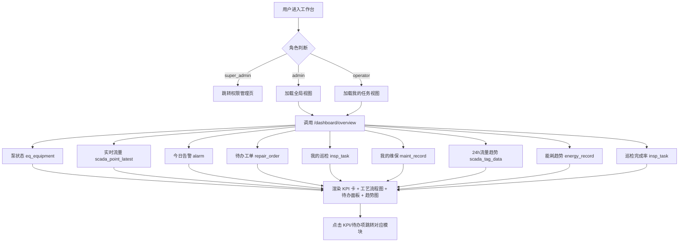

### 20.2 智能助手（AI Chat）对话流程

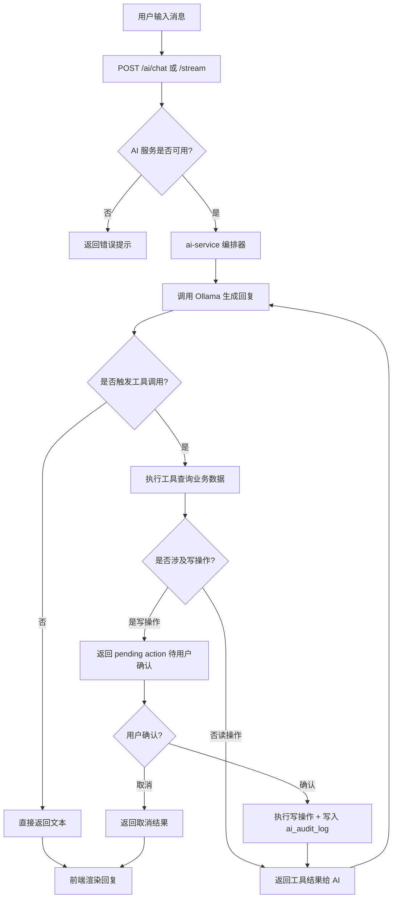

### 20.3 告警中心（Alarm）生成与处理流程

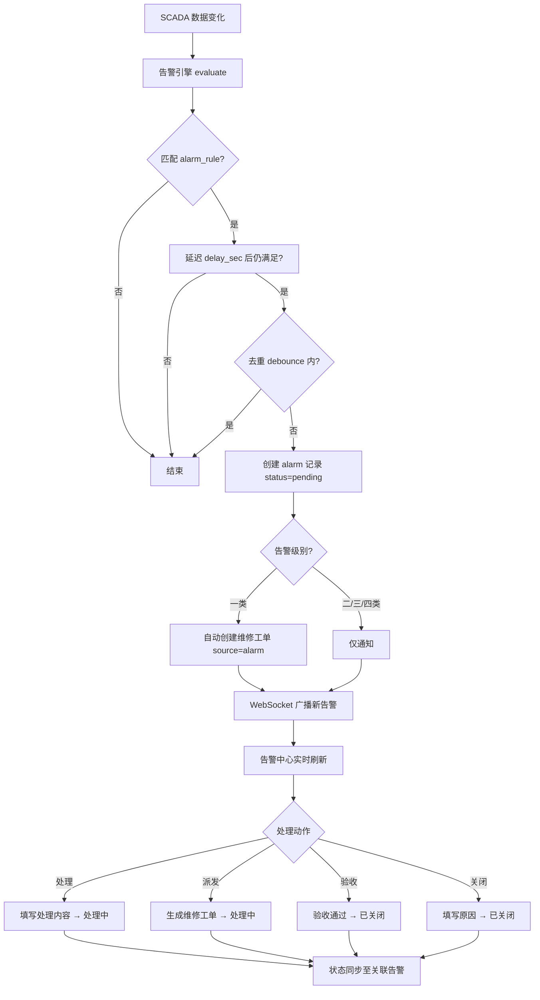

### 20.4 维修工单（Repair）全生命周期

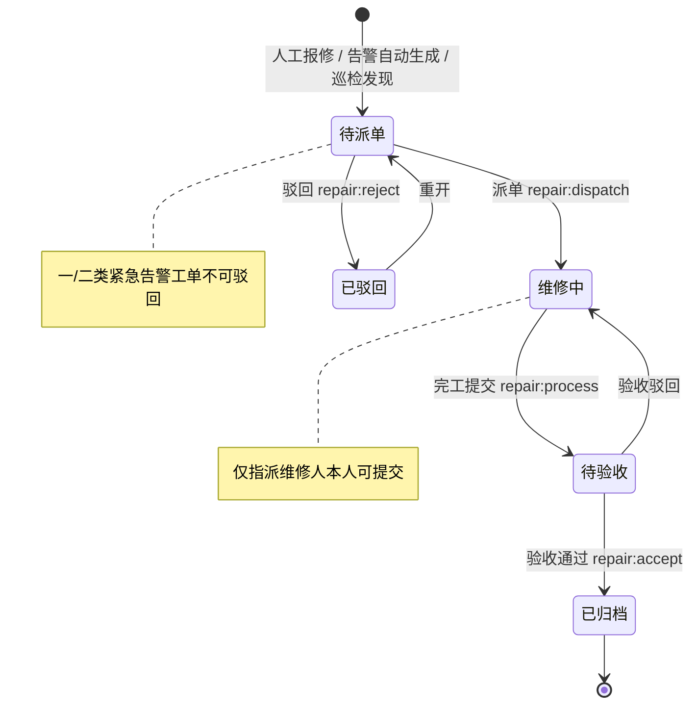

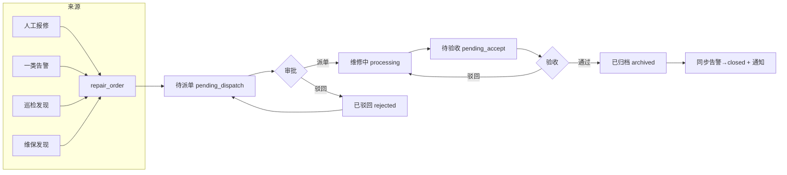

### 20.5 实时监控（SCADA）数据采集流程

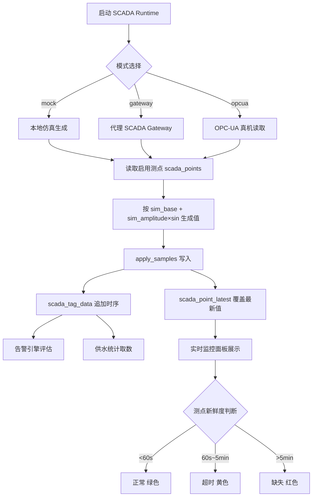

### 20.6 设备资产（Equipment）管理流程

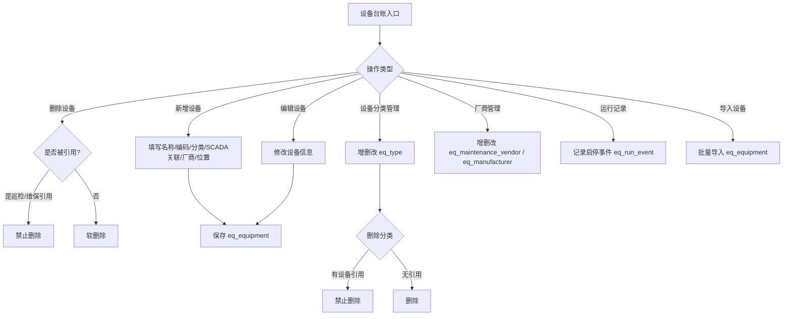

### 20.7 调度指令（Dispatch）审批执行闭环

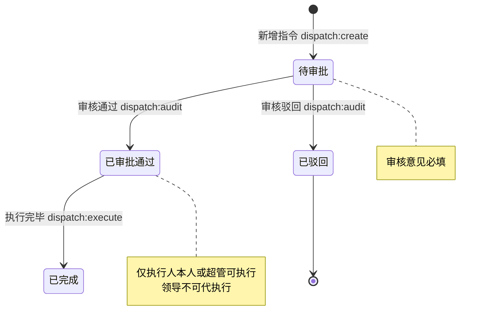

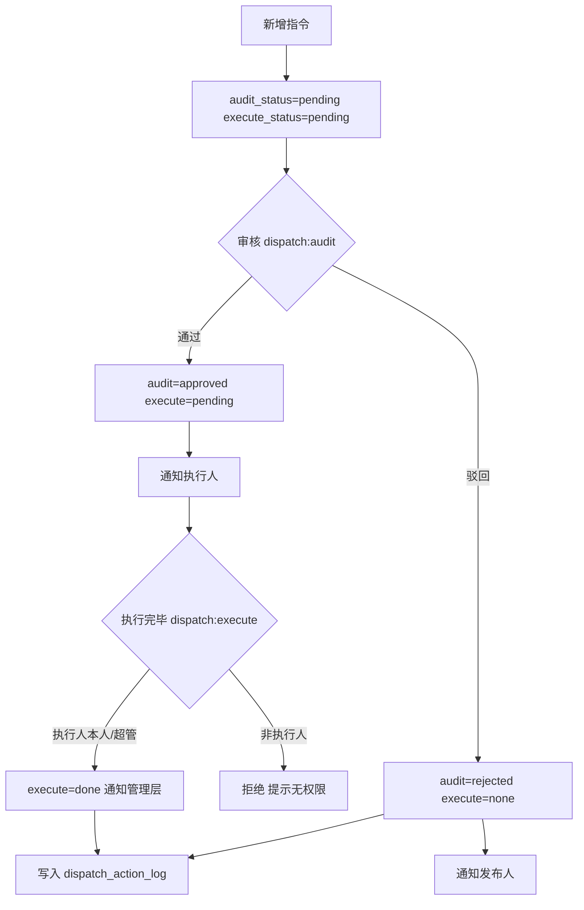

### 20.8 供水分析（Water）数据流程

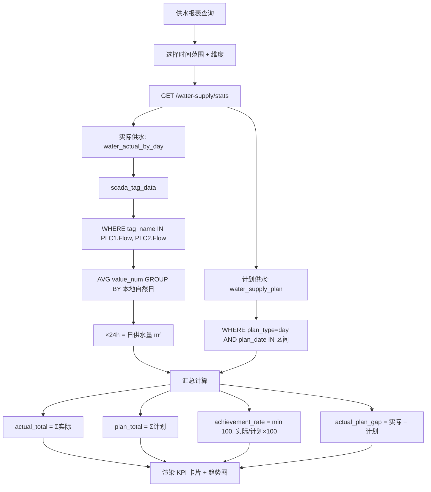

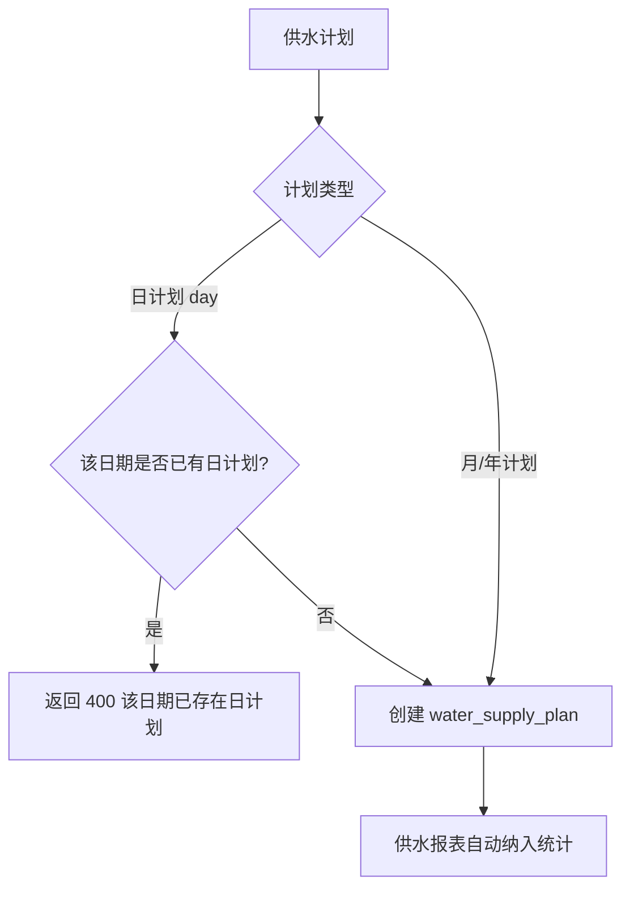

### 20.9 耗能分析（Energy）电费计算流程

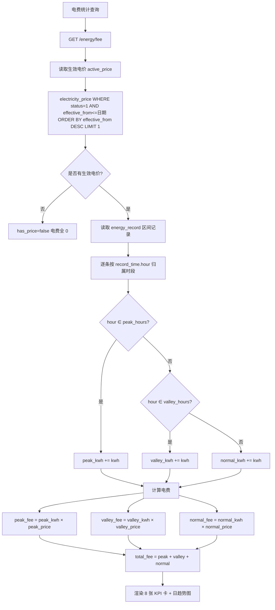

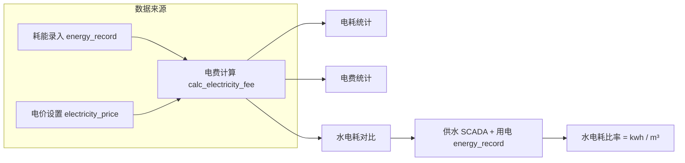

### 20.10 设备巡检（Inspection）闭环流程

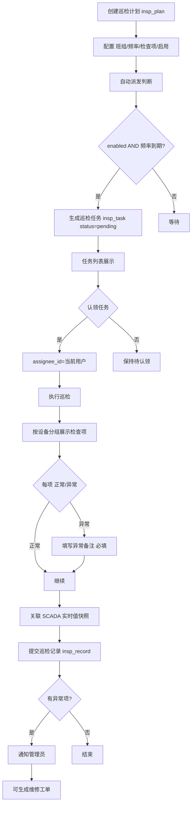

### 20.11 档案管理（Archive）流程

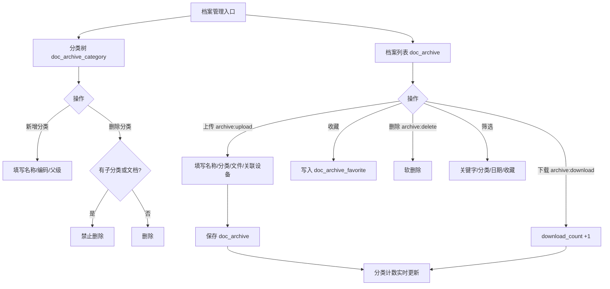

### 20.12 系统管理（System）权限分配流程

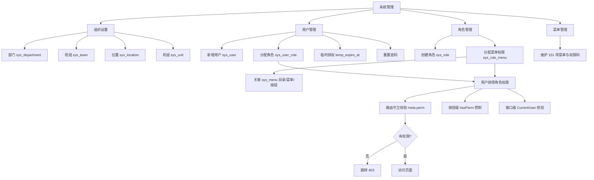

### 20.13 异常页（Exception）触发流程

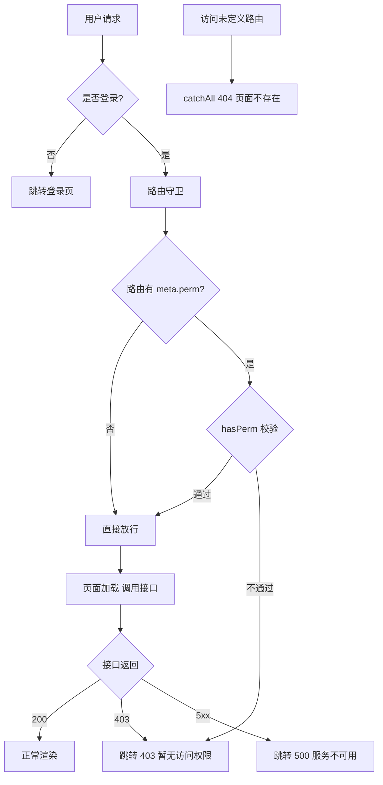

### 20.14 跨模块联动总览

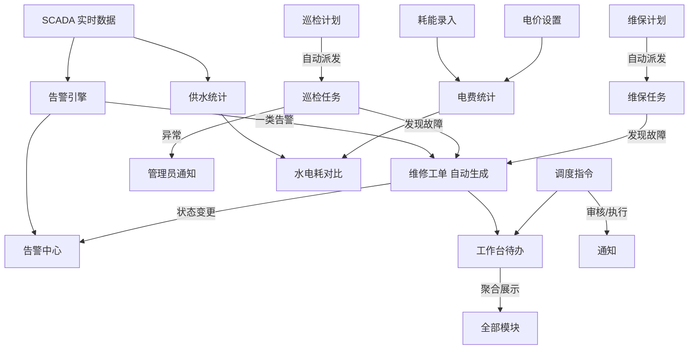

---

## 21. 附录

### 附录 A：数据库表清单（41 张）

| 分类 | 表名 | 用途 |
|---|---|---|
| SCADA | scada_points, scada_point_latest, scada_tag_data | 测点与时序数据 |
| 供水 | water_supply_plan | 供水计划 |
| 耗能 | energy_record, electricity_price | 耗能记录与电价 |
| 调度 | dispatch_instruction, dispatch_action_log | 调度指令与日志 |
| 告警 | alarm, alarm_rule, alarm_type, alarm_action_log, alarm_pending_state | 告警全链路 |
| 维修 | repair_order, repair_action_log | 维修工单与日志 |
| 巡检 | insp_plan, insp_task, insp_record | 巡检计划/任务/记录 |
| 维保 | maint_plan, maint_plan_equipment, maint_record | 维保计划与记录 |
| 设备 | eq_equipment, eq_type, eq_manufacturer, eq_maintenance_vendor, eq_run_event | 设备台账 |
| 档案 | doc_archive, doc_archive_category, doc_archive_favorite | 档案管理 |
| 系统 | sys_user, sys_role, sys_menu, sys_role_menu, sys_user_role, sys_department, sys_team, sys_location, sys_unit, sys_notification, sys_operation_log | 权限与组织 |
| AI | ai_audit_log | AI 审计 |

### 附录 B：技术栈

| 层级 | 技术 |
|---|---|
| 前端 | Vue 3 + TypeScript + Element Plus + ECharts |
| 后端 | FastAPI + SQLAlchemy + SQLite |
| SCADA | ScadaRuntime（mock/gateway/opcua）|
| AI | ai-service（Ollama + 工具调用）|
| 实时通信 | WebSocket（告警广播）|

### 附录 C：核心服务文件

| 服务 | 文件 | 职责 |
|---|---|---|
| 供水统计 | analytics_service.water_actual_by_day | SCADA 流量→日供水量 |
| 电费计算 | analytics_service.calc_electricity_fee | 峰谷平电费计算 |
| 电价生效 | analytics_service.active_price | 生效电价选取 |
| 告警引擎 | alarm_engine.engine | 规则评估、告警生成、自动建工单 |
| 维修状态机 | repair_service | 工单状态流转、告警同步 |
| 巡检派发 | inspection_service | 计划自动派发、执行闭环 |
| 维保派发 | maintenance_service | 周期自动派发、验收 |
| 调度状态机 | dispatch_service | 审核、执行、通知 |
| SCADA 仿真 | scada.simulator.ScadaRuntime | 测点值生成与写入 |
| AI 编排 | ai-service.agent.orchestrator | 对话与工具调用 |
