# 大张庄智慧管控平台— 产品功能设计文档

| 项目   | 内容                                                                                                                                                                                                                                                                                             |
| :--- | :--------------------------------------------------------------------------------------------------------------------------------------------------------------------------------------------------------------------------------------------------------------------------------------------- |
| 文档版本 | v1.6                                                                                                                                                                                                                                                                                           |
| 编写日期 | 2026-10-20                                                                                                                                                                                                                                                                                     |
| 最近修订 | **2026-11-07（v1.6）**：设备台账加载性能优化（树懒加载 + 接口字段裁剪 + 详情/下属设备按需加载）、详情区高度填充规则与卡片渐进式入场（§7.2）2026-10-29（v1.5）：①设备台账页面交互重构（左树结构、图标按钮、告警/工单徽标、响应式与滚动）；②点位表同步脚本落地 + SCADA 网关真机接入步骤补充（§6.3、§7.2、§15.1/15.2/15.7）2026-10-21（v1.1 对照施工方案与代码查漏补缺；v1.2 补入 RAG 知识库、通知中心、WebSocket 推送、系统审计日志、SCADA 网关接入；v1.3 明确 AI 只读边界——不参与任何业务操作，仅做只读查询、轨道二模型训练与 RAG 蒸馏；v1.4 新增操作日志页面（双 Tab）、审计详情生成与 180 天保留清理） |
| 覆盖范围 | 全部 13 个业务模块 + 异常页                                                                                                                                                                                                                                                                              |
| 适用读者 | 开发、测试、产品验收                                                                                                                                                                                                                                                                                     |

***

## 目录

1. [文档概述](#1-文档概述)
2. [工作台](#2-工作台dashboard)
3. [智能助手](#3-智能助手ai-chat)
4. [告警中心](#4-告警中心alarm)
5. [维修工单](#5-维修工单repair)
6. [实时监控](#6-实时监控scada)
7. [设备资产](#7-设备资产equipment)
8. [数据统计 — 供水分析](#8-数据统计--供水分析water)
9. [数据统计 — 耗能分析](#9-数据统计--耗能分析energy)
10. [设备巡检](#10-设备巡检inspection)
11. [设备维护](#11-设备维护maintenance)
12. [档案管理](#12-档案管理archive)
13. [系统管理](#13-系统管理system)
14. [异常页](#14-异常页exception)
15. [数据来源与采集链路](#15-数据来源与采集链路)
16. [权限模型](#16-权限模型)
17. [业务规则与约束汇总](#17-业务规则与约束汇总)
18. [异常场景处理](#18-异常场景处理)
19. [功能边界与依赖关系](#19-功能边界与依赖关系)
20. [交互流程图](#20-交互流程图)
21. [附录](#21-附录)

***

## 1. 文档概述

### 1.1 系统定位

面向泵站的生产运维管理平台，覆盖实时监控、告警、维修、巡检、维保、供水/耗能统计、档案、系统管理等全业务链路。

### 1.2 两条业务链路

平台围绕两条核心业务链路组织各模块：

**链路一 · 异常处置链**（数据驱动）

```
数据接入 → 运行分析 → 异常发现 → 告警处置 → 维修工单 → 处理反馈
```

- 涉及模块：SCADA 实时监控 → 双轨模型 / 告警中心 → 维修工单 → 工作台聚合

**链路二 · 巡查业务链**（计划驱动）

```
巡查计划 → 巡查执行 → 异常上报 → 维修处置
```

- 涉及模块：设备巡检 / 设备维护 → 维修工单 → 工作台聚合

### 1.3 模块清单

| 编号  | 模块   | 路由                         | 权限码                        | 数据来源类型              | 实现状态  |
| :-- | :--- | :------------------------- | :------------------------- | :------------------ | :---- |
| M1  | 工作台  | /dashboard                 | dashboard:view             | 全模块聚合               | ✅ 已实现 |
| M2  | 智能助手 | /ai/chat                   | 无（所有登录用户）                  | AI 服务               | ✅ 已实现 |
| M3  | 告警中心 | /alarm/realtime            | alarm:realtime             | SCADA + 规则引擎        | ✅ 已实现 |
| M4  | 维修工单 | /repair/list               | repair:list                | 人工报修 + 告警/巡检/维保自动转单 | ✅ 已实现 |
| M5  | 实时监控 | /scada/monitor             | scada:monitor              | SCADA 时序数据          | ✅ 已实现 |
| M6  | 设备资产 | /equipment/list            | eq:list                    | 手动录入                | ✅ 已实现 |
| M7  | 供水分析 | /water/stats               | water:stats                | SCADA + 手动计划        | ✅ 已实现 |
| M8  | 耗能分析 | /energy/stats              | energy:stats               | 手动录入 + 自动计算         | ✅ 已实现 |
| M9  | 设备巡检 | /inspection/tasks          | insp:task:list             | 计划自动派发 + SCADA 快照   | ✅ 已实现 |
| M10 | 设备维护 | /maintenance/plans         | maint:plan:list            | 计划自动派发 + 临时手动       | ✅ 已实现 |
| M11 | 档案管理 | /archive                   | archive:list               | 手动上传                | ✅ 已实现 |
| M12 | 系统管理 | /system/users、/system/logs | sys:user:list、sys:log:list | 手动配置                | ✅ 已实现 |
| M13 | 异常页  | /exception/\*              | -                          | 系统级                 | ✅ 已实现 |

### 1.4 通用能力

以下能力跨业务模块统一提供，不在各模块章节重复描述：

| 能力     | 说明                                       | 覆盖范围              |
| :----- | :--------------------------------------- | :---------------- |
| 报表导出   | 列表/统计数据导出 Excel（文件名按模块命名），支持当前筛选条件下的结果导出 | 全部列表页与统计分析页       |
| 列显隐设置  | 表格右上角"列设置"，勾选需要显示的列                      | 全部表格页             |
| 刷新     | 手动重新拉取最新数据                               | 全部列表页             |
| 分页     | 底部切换每页条数（默认 20 条）与翻页                     | 全部列表页             |
| 详情抽屉   | 右侧滑出，集中展示单条记录完整信息，部分抽屉底部提供操作按钮           | 全部业务对象            |
| 跨页定位高亮 | 带参跳转 + 命中行浅蓝底 + 左侧蓝条标记                   | 工作台→业务模块、工艺图→设备台账 |
| 消息通知   | 顶栏铃铛展示未读通知，点击跳转关联业务；机制见 1.5              | 告警/工单/巡检/维保       |
| 业务操作日志 | 关键业务动作自动记录（ ` *_action_log`）             | 告警/工单/巡检/维保       |
| 系统操作日志 | 中间件记录写操作/登录/下载并生成中文操作内容；页面见 1.6          | 全部写接口             |
| 全局悬浮助手 | 任意页面右下角呼出 AI 对话面板（`AiFloatAssistant`）    | 全部页面              |
| 声光报警   | 一类告警触发时联动声光提醒（按施工方案要求）                   | 告警中心              |
| 现场拍照   | 报修、巡检、维保执行可上传现场图片作为辅助依据                  | 维修工单/设备巡检/设备维护    |

### 1.5 通知中心与实时推送

#### 通知中心（Notification）

- 未读数：`GET /api/v1/notifications/unread-count`
- 单条已读：`POST /api/v1/notifications/{id}/read`
- 全部已读：`POST /api/v1/notifications/read-all`
- 通知产生来源：告警、工单派单/完成、巡检异常、维保派发/验收等业务事件

**数据来源**：`sys_notification` 表；接口 `/api/v1/notifications/*`

#### WebSocket 实时推送

| 通道                  | 鉴权      | 推送内容          |
| :------------------ | :------ | :------------ |
| `/ws/notifications` | JWT 用户级 | 待办/通知实时推送     |
| `/ws/alarms`        | JWT     | 告警产生/状态变更实时广播 |

- 连接建立时校验 token，断线由前端重连
- 告警推送由告警引擎经 `alarm_ws_hub` 广播；用户级推送经 `user_ws_hub`

**数据来源**：`backend/app/api/ws.py`、`app/alarm_engine/ws_hub.py`、`app/services/user_ws.py`

### 1.6 操作日志（系统操作日志 + 业务流转日志）

页面入口：系统管理 > 操作日志（`/system/logs`，权限码 `sys:log:list`），双 Tab 聚合展示。

**Tab 一：系统操作日志**（`sys_operation_log`）

由 `OperationLogMiddleware` 自动记录，只记**写操作**与关键行为，不记查询：

- 采集范围：`POST/PUT/PATCH/DELETE` + 登录 + 含 `/download` 的请求
- 跳过：`/docs`、`/redoc`、`/openapi.json`、`/favicon.ico`、`/api/v1/internal/*`（SCADA 秒级上报与档案内部接口，非人工操作）
- 记录字段：操作人、方法、路径、状态码、IP、UA、耗时、操作内容（`detail`）
- `detail` 由「模块 · 动作 · #对象ID」自动生成（如「维修工单 · 派单 · #12」），登录请求的操作用户名由登录接口回填
- 查询：`GET /api/v1/audit/operation-logs`，支持时间范围、操作人、模块、方法、结果（成功/失败）、路径筛选 + 分页
- 下拉选项：`GET /api/v1/audit/options`（模块 / 方法）
- 保留策略：`audit_log_retention_days`（默认 180 天），由调度器每小时清理超期记录

**Tab 二：业务流转日志**（`alarm_action_log` + `repair_action_log`）

- 聚合告警与维修工单的流转动作，按时间倒序合并分页
- 查询：`GET /api/v1/audit/business-logs`，支持业务类型（告警/维修）、操作人、时间范围筛选
- 动作码在前端映射为中文（如 `created` → 告警生成、`dispatch` → 派单）
- 业务留痕长期保留，不参与 180 天清理

**数据来源**：`backend/app/main.py`（中间件注册）、`app/core/middleware.py`（采集与详情解析）、`app/models/archive.py`（OperationLog）、`app/api/audit.py`、`app/services/audit_service.py`、`frontend/src/views/system/LogsView.vue`

***

## 2. 工作台（Dashboard）

### 2.1 功能说明

泵站首页总览，聚合告警、工单、巡检、维保、供水、耗能等核心数据，按角色差异化展示（全局视图 / 操作员我的任务视图）。

### 2.2 功能点

#### F-D1 KPI 指标卡

展示关键运营指标，点击可跳转对应模块。含"在线监控中"状态标识。

**数据来源**：`GET /api/v1/dashboard/overview`

- 泵状态：`eq_equipment.running_status`
- 实时流量：`scada_point_latest`（PLC1.Flow + PLC2.Flow）
- 今日告警：`alarm` 表 `alarm_time` 为今日
- 待办计数：`RepairOrder` + `Alarm` + `InspectionTask` + `MaintenanceRecord`

#### F-D2 工艺流程图与泵组状态

展示泵站工艺流程，泵组带运行状态徽章。点击泵组弹出：实时工况、健康状态、台账信息、运维情况。

**数据来源**：

- 设备台账：`eq_equipment`
- 实时工况：`scada_point_latest`
- 健康状态：设备关联健康测点

#### F-D3 待办面板（右侧）

四个待办列表：综合告警、待处理工单、我的巡检任务、我的维保任务。每项带"更多"跳转。

**数据来源**：`/dashboard/overview` 待办列表接口

- 综合告警：`alarm` 未处理
- 待处理工单：`repair_order` 待派单/处理中
- 我的巡检：`insp_task` `assignee_id=当前用户` 且待执行
- 我的维保：`maint_record` `operator_id=当前用户` 且待执行

**操作员视图**：`is_mine_scope=true`，仅展示与当前用户相关的待办。

#### F-D4 趋势图表

- 24h 流量趋势：`scada_tag_data` 按小时聚合
- 能耗趋势：`energy_record` 按日聚合
- 巡检完成率：`insp_task` 已完成 / 总数

### 2.3 角色差异化

| 角色   | 工作台内容                  |
| :--- | :--------------------- |
| 领导   | 全局 KPI + 全量待办 + 趋势图    |
| 操作员  | 我的任务分布 + 机组运行状态 + 我的待办 |

**注意**：`super_admin` 角色**仅有系统管理权限**，不展示工作台，登录后直接跳转权限管理页。

***

## 3. 智能助手（AI Chat）

### 3.1 功能说明

基于大模型的智能对话助手，支持只读工具调用（查询设备、告警、工单等）与知识库问答（RAG），所有登录用户可用。

**定位（重要）**：AI 属**轨二通用能力层**，只做三件事——业务数据只读查询、模型训练、RAG 蒸馏与语义检索。**不参与任何业务操作**：不创建、不修改、不流转任何业务单据，所有业务动作由人在页面完成并受 RBAC 与状态机约束。

入口两处：`/ai/chat` 独立页面 + **全局悬浮助手**（任意页面右下角呼出对话面板，`AiFloatAssistant` 组件）。

### 3.2 功能点

#### F-A1 对话交互

- 支持非流式 `/ai/chat` 和 SSE 流式 `/ai/chat/stream` 两种模式
- 流式事件协议：`status` / `tool`（工具调用过程）/ `token`（增量文本）/ `done` / `error`
- 支持多轮会话，会话历史持久化
- 工具调用仅用于取数，不回写业务数据

**数据来源**：

- 主站代理：`backend/app/api/ai.py` → `ai_client.py` → `ai-service`
- AI 服务：`ai-service/app/agent/orchestrator.py`（调用 Ollama + 只读工具执行）

#### F-A2 工具调用

AI 可调用工具查询业务数据（设备、告警、工单、巡检等），工具执行结果回传 AI 生成回答。

#### F-A3 能力边界（只读，不参与任何业务操作）

AI 在当前交付范围内的职责严格限定为三类，均不产生业务副作用：

| 能力     | 内容                  | 说明                             |
| :----- | :------------------ | :----------------------------- |
| 只读查询   | 设备、告警、工单、巡检、维保等数据检索 | 通过工具调用取数，结果仅用于生成回答             |
| RAG 蒸馏 | 档案文本提取、分块、向量化、语义检索  | 把业务档案蒸馏为可检索知识（见 F-A4）          |
| 模型训练   | 轨二通用统计模型的数据训练与迭代    | 输出进入告警体系（见 4.5 F-AL7），不直接改业务数据 |

约束：

- 不存在"AI 直接创建/修改业务单据"的链路；报修、派单、验收等动作一律由人在页面操作
- 代码中的 `create_repair_order` 等写工具及 `/ai/actions/*`、`ai_audit_log` 为早期设计遗留，**当前交付不启用、不作为功能项**
- 因此操作日志页面不设「AI 操作审计」Tab

#### F-A4 知识库问答（RAG）

档案类问题优先走知识库检索，AI 基于检索内容回答：

- `search_knowledge` / `list_archives` 工具：按问题向量检索档案片段（携带档案名元数据）
- 知识来源：档案管理上传的文档自动索引（见 12.2 F-AR4）
- 索引管理接口：`POST /rag/index`（按档案索引）、`DELETE /rag/index/{archive_id}`（删除索引）、`POST /rag/reindex`（全量重建）、`POST /rag/search`（检索调试）

**数据来源**：`ai-service/app/rag/indexer.py`（下载 → 文本提取 → 分块 → embedding → 向量库）、`rag/store.py`（向量存储与相似度检索）

### 3.3 异常处理

- AI 服务不可用 → 返回错误提示，不影响主站
- 流式连接中断 → 前端展示已接收内容 + 错误提示

***

## 4. 告警中心（Alarm）

### 4.1 功能说明

实时告警监控与处理，含实时告警、告警规则、历史告警、告警类型四个 Tab。

### 4.2 功能点

#### F-AL1 实时告警列表

- 筛选：状态（未处理/处理中/待验收/已关闭）、等级（一/二/三类）、类型、设备、未指派/已派工、mine
- KPI 卡片互斥：待指派、未处理、处理中、待验收、全部，点击筛选，再次点击取消

**告警等级**（`alarm_level`，schema 校验 `ge=1, le=3`）：

| 等级 | 中文   | 处置方式                 |
| :- | :--- | :------------------- |
| 1  | 一类紧急 | 声光报警 + 自动生成维修工单      |
| 2  | 二类重要 | 提示，由运行人员根据实际情况发起维修处理 |
| 3  | 三类一般 | 提醒关注，根据实际情况检查或进一步处理  |

**告警状态**（`alarm_status`，互斥）：`pending` 未处理 / `processing` 处理中 / `pending_accept` 待验收 / `closed` 已关闭 / `rejected` 已驳回 / `reopened` 已重开；派生状态 `unassigned` **待指派** = 未闭环且未关联维修工单。

**数据来源**：`GET /api/v1/alarms`，表 `alarm`

#### F-AL2 告警处理（处理/派发/验收/关闭）

| 操作   | 权限             | 说明            |
| :--- | :------------- | :------------ |
| 处理告警 | alarm:handle   | 填写处理内容，状态→处理中 |
| 派发告警 | alarm:dispatch | 生成维修工单，状态→处理中 |
| 验收告警 | alarm:accept   | 填写验收意见，状态→已关闭 |
| 关闭告警 | alarm:close    | 填写关闭原因，状态→已关闭 |

**告警状态互斥口径**：未处理 / 处理中 / 待验收 / 已关闭 / 已驳回 / 已重开，同一时刻仅一种状态。

#### F-AL3 告警规则

配置触发规则：设备、测点、告警类型、级别、触发逻辑（比较运算 + 阈值）、延迟、去重、抑制推送。

**数据来源**：`alarm_rule` 表

#### F-AL4 告警类型

维护告警类型字典（名称、编码、描述）。

**数据来源**：`alarm_type` 表

#### F-AL5 历史告警

已闭环或驳回的告警归档查询，与实时告警分 Tab 展示。

- 数据域：`alarm_status IN (closed, rejected, reopened)`，未选状态时默认三者
- 筛选：时间范围、设备、类型、等级、状态
- 详情：告警触发值、处理日志（`alarm_action_log`）、关联维修工单
- KPI 卡片：按一类/二类/三类/已驳回分别统计

**数据来源**：`GET /api/v1/alarms?scope=history`，表 `alarm` + `alarm_action_log`

### 4.3 告警引擎（自动）

```
SCADA 数据变化 → alarm_engine.evaluate()
  ├─ 匹配 alarm_rule（测点、阈值、比较运算）
  ├─ 延迟 delay_sec 后仍满足 → 触发
  ├─ 去重 debounce_sec 内不重复
  ├─ 创建 alarm 记录（alarm_status=pending）
  ├─ 一类告警 → 自动创建维修工单（source="alarm"）
  └─ WebSocket 广播新告警
```

**数据来源**：

- 规则：`alarm_rule`
- 告警：`alarm`
- 操作日志：`alarm_action_log`
- 去重状态：`alarm_pending_state`

### 4.4 告警与工单联动

- 一类告警自动生成维修工单（`repair_order.alarm_id` 关联）
- 工单状态变更 → 回写关联告警状态（pending→processing→pending\_accept→closed）
- 广播 `alarm.updated` 事件

### 4.5 双轨模型（智控一体化扩展）

> 智控一体化平台在现有规则引擎之上扩展"双轨模型"分析能力，模型输出统一进入现有告警体系，不单独形成另一套告警系统。

#### F-AL6 轨一 · 专项机理模型

依据设备运行机理、技术参数、现场运行规则及实际接入的监测数据，对明确异常状态实时判断。

- **监测对象**：温度、振动、电压、电流、设备运行状态、保护动作
- **判断方式**：参数越限 / 持续异常 / 运行状态异常 / 设备状态逻辑判断
- **高频振动分析**：具备高频数据条件的设备可开展时域 / 频域特征分析
- **参数确定**：阈值与触发条件在实施过程中结合设备资料、现有报警参数及运行要求确定，不预设无现场依据的算法参数

#### F-AL7 轨二 · 通用统计模型

利用平台持续积累的有效历史运行数据，对具备连续数据条件的监测参数进行趋势统计与状态偏离分析。

- 历史运行趋势分析
- 同一设备不同时期运行状态对比
- 运行参数变化趋势分析
- 正常运行参考状态分析
- 状态偏离识别

**实施原则**：逐步积累、逐步分析。投运初期先完成数据积累与基本趋势分析，随有效数据增加逐步形成正常运行参考状态。对历史数据不足或连续性不满足的对象，不产生缺乏数据依据的确定性故障判断。

#### F-AL8 双轨模型与告警体系统一

平台统一接收四类来源进入现有告警管理：

1. 现有系统产生的告警事件
2. 基础告警规则（`alarm_rule`）触发的异常
3. 轨一专项机理模型产生的异常
4. 轨二统计分析产生的状态异常提示

模型输出按告警类型、等级、设备、测点进入 `alarm` 表，走统一的去重、推送、工单联动流程。

***

## 5. 维修工单（Repair）

### 5.1 功能说明

维修工单全生命周期管理，含列表、审批、处理、验收。共**四种来源**：人工报修（手动）、告警自动生成、巡检发现转单、维保发现转单（详见 5.3 工单来源）。

### 5.2 工单状态机

```
[pending_dispatch 待派单]
    │
    ├─ 派单 → [processing 维修中]
    └─ 驳回 → [rejected 已驳回]
                │
                └─ 重开 → [pending_dispatch]

[processing 维修中]
    │
    └─ 完工提交 → [pending_accept 待验收]

[pending_accept 待验收]
    │
    ├─ 验收通过 → [archived 已归档]
    └─ 验收驳回 → [processing 维修中]
```

### 5.3 功能点

#### F-R1 工单列表

- 筛选：状态、阶段（approve/process/accept）、工单号、设备、来源、mine
- 来源：人工报修（manual）/ 告警自动（alarm）/ 巡检发现（inspection）/ 维保发现（maintenance）

**数据来源**：`GET /api/v1/repairs`，表 `repair_order`

#### 工单来源汇总（source 字段实际取值）

| source        | 来源     | 触发方式                                      | 关联字段                                    |
| :------------ | :----- | :---------------------------------------- | :-------------------------------------- |
| `alarm`       | 告警自动生成 | 一类告警由告警引擎自动建单                             | `alarm_id`                              |
| `manual`      | 人工报修   | 用户手动填写创建                                  | -                                       |
| `inspection`  | 巡检发现   | 从巡检记录页发起转单                                | `inspection_record_id`（记录页据此反查展示「关联工单」） |
| `maintenance` | 维保发现   | 完成维保时填写"发现异常"自动转单，描述前缀「【维保转维修】」，工单号回写维保备注 | `maintenance_record_id`（维保记录页反查）        |

> 注：模型注释中 `source` 仅标 `alarm / manual` 为过时注释，代码实际已支持四种取值（`api/repair.py`、`api/maintenance.py`）。

#### F-R2 人工报修

填写设备、故障描述、故障时间、图片，提交后状态为 `pending_dispatch`。

**权限**：`repair:create`

#### F-R3 审批派单 / 驳回

- 派单：指定维修人，状态→`processing`
- 驳回：填写驳回原因，状态→`rejected`
- **约束**：一/二类紧急告警工单不可驳回

**权限**：`repair:dispatch` / `repair:reject`

#### F-R4 完工提交

维修人填写处理反馈、图片，状态→`pending_accept`。

**权限**：`repair:process`，且仅指派维修人本人可操作

#### F-R5 工单验收

- 验收通过：状态→`archived`，关联告警→`closed`
- 验收驳回：状态→`processing`，关联告警→`processing`

**权限**：`repair:accept`

### 5.4 数据来源

- **接口**：`/api/v1/repairs`、`/repairs/{id}/dispatch`、`/reject`、`/complete`、`/accept`
- **存储**：`repair_order`、`repair_action_log`
- **服务**：`repair_service.py`（状态机 + 告警同步 + 通知）

***

## 6. 实时监控（SCADA）

### 6.1 功能说明

SCADA 测点实时监控与测点配置，支持 mock 仿真和 gateway/opcua 真机模式。

### 6.2 功能点

#### F-SC1 实时监控面板

- 展示所有启用测点的最新值、质量状态、时间戳
- 测点新鲜度规则：<60s 正常 / 60s\~5min 超时 / >5min 缺失
- 每 2 秒自动刷新

**数据来源**：`GET /scada/latest`、`/scada/runtime/status`

- 最新值：`scada_point_latest` 表
- 历史值：`scada_tag_data` 表

#### F-SC2 运行时控制

- 启动 / 停止 SCADA 采集
- 模式切换：mock（本地仿真）/ gateway（网关代理）/ opcua（真机）
- 采样间隔配置

**数据来源**：`POST /scada/runtime/start|stop`

- mock 模式：`ScadaRuntime` 每秒生成测点值（`sim_base + sim_amplitude × sin`）
- gateway 模式：代理到 SCADA Gateway HTTP 接口

#### F-SC3 测点配置（Tab）

配置 SCADA 测点：测点名、节点、数据类型、单位、描述、仿真参数（base/amplitude/period）、启用状态。

**权限**：`scada:point:create/update/delete`、`scada:sim:control`

**数据来源**：`scada_points` 表

### 6.3 SCADA 数据写入链路

> 【2026-10-29 更新】补充 gateway 真机通道与点位表现状；原表格中的 8 个 mock 演示测点已替换为真实点位表。

```
① 仿真通道（scada_mode=mock，开发/演示用）
ScadaRuntime.tick()（每秒）
  → 读取启用测点 scada_points，按 sim_base/amplitude/period 生成正弦值
  → apply_samples() 写 scada_point_latest（覆盖）+ scada_tag_data（追加）
  → 触发告警引擎

② 真机通道（scada_mode=gateway，现场用）
scada-gateway（8100）按 gw_points 的 node_id 订阅 OPC UA
  → Sample(tag_name, value_num/bool/str, ts_ms)
  → POST /api/v1/internal/scada/samples（X-Gateway-Token）
  → ingest_samples() 按 tag_name 映射主站点位 → apply_samples()（同上）
```

**点位表现状（2026-10-29）**：

| 项目                    | 数量       | 说明                                                                                                          |
| :-------------------- | :------- | :---------------------------------------------------------------------------------------------------------- |
| 点位表 `scada_points`    | 1,377 条  | 现场真实点表（DZZDB）导入，含 NodeId、量程、Hi/Lo、告警组、IO 访问权限                                                               |
| 历史时序 `scada_tag_data` | 61,824 条 | 5 份机组运行日报 ETL，112 个 tag × 552 点，覆盖 2026-10-27 16:00 \~ 10-28 15:57                                          |
| 流量测点                  | 4 条      | `PLC1.Flow`、`PLC2.Flow`（大张庄 1#/2#）、`PS02_PUMP01_FLOW`、`PS02_PUMP02_FLOW`（二号泵站），单位 m³/h；**当前无历史数据**，需真机接入后生成 |

⚠️ 日报（25 列）只含水位、电压电流、功率、温度、叶片角度等，**不含流量字段**，因此供水量历史无法从日报补齐，只能靠 SCADA 实时采集。

***

## 7. 设备资产（Equipment）

### 7.1 功能说明

设备台账管理，含设备列表、分类、厂商管理、运行记录。

### 7.2 功能点

#### F-EQ1 设备台账

- 设备字段：名称、编码、分类、SCADA 关联测点（健康/消防/安防）、厂商、部门、位置、投运日期、维保周期、运行状态
- 支持导入

**数据来源**：`eq_equipment` 表

#### F-EQ2 设备分类

维护设备分类树（名称、编码、描述）。

**约束**：删除分类前检查是否被设备引用，有引用则禁止删除。

**数据来源**：`eq_type` 表

#### F-EQ3 厂商管理

维护维保厂商和生产厂商信息。

**数据来源**：`eq_maintenance_vendor`、`eq_manufacturer`

#### F-EQ4 运行记录

记录设备启停事件（事件类型、时间、来源、备注）。

**数据来源**：`eq_run_event` 表

#### F-EQ5 设备台账页面（档案树 + 详情）

> 【2026-10-29 新增】本页交互按设计图重构，以下为当前实现口径。

**左侧设备档案树**

- 头部：标题「设备列表」+ 台数胶囊；右上角两个**圆形图标按钮**（新增=蓝色实心「+」、导出=蓝色描边下载图标），均带 hover 提示与权限控制（`eq:create`）
- 搜索框：「搜索机组或设备」，与分类 chips 联动（先按分类过滤，再套搜索词）
- 分类 chips：全部 / 运行中 / 有告警
- 列表小表头：`运行状态 | 关联事项`
- 树节点：彩色分类图标（浅色底）+ 短名称（**不显示「N号机组-」前缀**，拼接名只在详情顶部展示）+ 状态点与文字（运行中绿 / 停机灰 / 未接入浅灰）+ 关联事项徽标
- 关联事项徽标：
  - 告警铃铛（按最高级别取色，>99 显示 `99+`）→ 点击切到本页「告警记录」Tab，**不做跨页高亮**
  - 工单文档图标 + 未闭环工单数（`repair_order` 按 `equipment_id` 聚合）→ 点击跳维修工单页并 `?focus=` 高亮该工单

**右侧设备详情**

- 顶部：状态标签（运行中=动态心电、停机=红色直线、未接入=灰色）、待检修/检修中标签、告警徽标统一为 **34px 高胶囊**样式，视觉与左侧运行状态等高
- 待检修 / 检修中标签 → 点击跳维修工单页，**全量列表 + 单条高亮**（仅传 `?focus=`，不带筛选参数）
- 操作按钮：编辑资料 / 设备报修 / 删除设备（`eq:update`、`repair:create`、`eq:delete`）；**<1440px 时收为三个图标按钮**（文字隐藏、保留 title 提示）
- 下属设备：每页 6 个，超出显示「更多」→ 展开右侧浮动「全部设备」面板
- 设备概况：7 张示意图按分类映射（闸门 / 真空 / 技术供水 / 排水 / 净水 / 供配电 / 监测仪表）
- 告警记录 Tab：未处理、未关闭在上，已关闭在下
- 卡片/列表视图切换：**仅 >1600px 显示**；≤1600px 隐藏设备概况与运维概况侧栏

**滚动与响应式**

- 仅列表区内部滚动，右侧概况区不滚动、不显示滚动条
- 页面最小高度 620px；视口高度 <900px 时由外层 `#app-main` 出现整页滚动条（对齐告警中心响应式策略）
- 断点：≤1600px 隐藏概况侧栏与视图切换、≤1440px 操作按钮图标化、≤820/720px 卡片网格自适应并隐藏左树
- 末级设备（无下属设备）时，详情主卡向下占满整个右列；父级设备时由「下属设备」卡占底部，主卡与下属设备卡合计填满，底部不留空白

**加载与性能（2026-11-07 优化）**

- 树默认懒加载：首屏只取顶级设备（14 条，约 4KB），展开节点才请求直接子节点（约 1.9KB/层）
- 自动回退全量：出现搜索词、分类 chips、KPI 筛选或携带 `equipment_id` 直入时切回 `tree=true`，保证深层节点可搜、可定位
- 树接口字段裁剪：节点仅返回 12 个渲染字段 + `is_leaf`（原 40+ 字段、141KB → 35KB，降 75%）；完整档案由 `/equipment/{id}` 按需加载
- 下属设备按需：选中节点后以 `lazy=true&parent_id=` 拉取直接子设备，替代前端遍历 `children`
- 徽章由服务端按子树汇总（`alarm_total` / `alarm_level` / `repair_total`），前端不再全树遍历
- 首屏并发：设备树与 3 个下拉 options 并行；统计卡、告警数、维修数在树渲染后补齐，不阻塞解除 loading
- 默认选中一号机组，并触发其详情与下属设备加载

**数据来源**：`eq_equipment`、`alarm`、`repair_order`、`scada_point_latest`、`scada_tag_data`

### 7.3 权限

`eq:list/create/update/delete/import`、`eq:type:*`、`eq:maintainer:*`、`eq:mfr:*`、`eq:run:event`

***

## 8. 数据统计 — 供水分析（Water）

### 8.1 供水报表

#### KPI 卡片

| 卡片          | 计算口径                  | 数据源                 |
| :---------- | :-------------------- | :------------------ |
| 实际供水合计 (m³) | Σ(日均流量 × 24h)         | scada\_tag\_data    |
| 计划合计 (m³)   | Σ 日计划值                | water\_supply\_plan |
| 计划完成率 (%)   | min(100, 实际/计划 × 100) | 计算                  |
| 超计划/缺口 (m³) | 实际 − 计划               | 计算                  |

**实际供水计算**：`water_actual_by_day()` — 取点位表中 `tag_name ilike '%flow%'` 或描述含「流量」的测点（当前 4 个：`PLC1.Flow`、`PLC2.Flow`、`PS02_PUMP01_FLOW`、`PS02_PUMP02_FLOW`），按 `AVG(value_num) GROUP BY 本地自然日` 求日均 m³/h，再 ×24。

> 【2026-10-29 更新】①该口径为「日均流量×24」估算，非累计水量积分；②4 个流量点分属大张庄（PLC1/PLC2）与二号泵站（PS02\_\*），当前统计为**全部相加**，如需按站分开需增加场站筛选；③这 4 个点目前无历史数据，真机接入后才出数。

### 8.2 供水计划

- 类型：day / month / year
- **日计划唯一性**：同一 `plan_date` 仅一条 `plan_type='day'`（创建和更新时均校验）
- 数据来源：`water_supply_plan` 表

### 8.3 供水对比

- 按测点：各流量测点当日供水量柱状图
- 按时段：时段供水量对比
- 数据来源：`scada_tag_data`

***

## 9. 数据统计 — 耗能分析（Energy）

### 9.1 电耗统计

- 维度：按日 / 按机组
- 数据来源：`energy_record`，`SUM(electricity_kwh) GROUP BY 日期/机组`
- 布局：图表与表格各占 50% 高度

### 9.2 耗能录入

- 字段：记录时间、机组、耗电量(kWh)、备注
- 数据来源：`energy_record` 表
- 记录时间的小时用于峰谷平归属

### 9.3 电费统计

**峰谷平划分**：

```
peak_hours   = "8,9,10,18,19,20"（默认）
valley_hours = "0,1,2,3,4,5,23"（默认）
其余小时 = 平时段
```

**电价生效规则** `active_price()`：

```
WHERE deleted=0 AND status=1 AND effective_from <= 查询日期
ORDER BY effective_from DESC
取第一条
```

**电费计算**：

```
peak_fee   = Σ(kwh × peak_price)   WHERE hour ∈ peak_hours
valley_fee = Σ(kwh × valley_price) WHERE hour ∈ valley_hours
normal_fee = Σ(kwh × normal_price) WHERE hour ∉ peak ∧ hour ∉ valley
total_fee  = peak_fee + valley_fee + normal_fee
```

**KPI 卡片**（两组各 4 张）：总电费/峰时/平时/谷时电费，总电量/峰时/平时/谷时电量。

### 9.4 水电耗对比

- 供水数据：`scada_tag_data`
- 用电数据：`energy_record`
- 水电耗比率 = electricity\_kwh / water\_m³
- 两张独立卡片：趋势卡 + 泵组对比卡

### 9.5 电价设置

- 字段：名称、峰/谷/平电价、峰/谷时段、生效日期范围
- 数据来源：`electricity_price` 表
- 约束：峰谷时段不重叠

***

## 10. 设备巡检（Inspection）

### 10.1 功能说明

巡检计划管理、任务自动派发、巡检执行、记录归档。

### 10.2 功能点

#### F-IN1 巡检计划

- 字段：名称、班组、起止日期、频率（day/week/month）、检查项(JSON)、启用状态
- 自动派发规则：`enabled AND start_date <= today AND (frequency 到期)` → 生成巡检任务

**数据来源**：`insp_plan` 表

#### F-IN2 巡检任务

- 状态：待认领 / 执行中 / 已完成
- 认领任务 → 执行巡检（按设备分组检查项，正常/异常，异常备注必填）
- 异常项 → 通知管理员
- SCADA 实时值快照：执行时关联测点当前值

**数据来源**：`insp_task` 表，服务 `inspection_service.py`

#### F-IN3 巡检记录

执行完成后生成巡检记录，含检查项结果汇总、异常标记。

**数据来源**：`insp_record` 表

### 10.3 权限

`insp:plan:create/update/delete`、`insp:task:create/update/delete`、`insp:record:submit`

***

## 11. 设备维护（Maintenance）

> 命名说明：本模块在系统菜单与页面中统一称为「**设备维护**」，归属「设备资产」菜单组（与设备台账、厂商管理同级），路由 `/maintenance/plans`，页面权限 `maint:plan:list`。文档中"维保计划 / 维保记录 / 维保验收"均为该模块内的业务对象术语。

### 11.1 功能说明

以**维保计划**驱动周期性保养工作，覆盖计划配置、自动/手动派发、执行、验收、保养记录归档的完整闭环，同时支持无计划的临时维保。

### 11.2 功能点

#### F-MT1 维保计划

- 字段：计划名称、计划类型（`overhaul` 大修 / `lubrication` 润滑）、开始时间、周期 `cycle_days`、提前通知 `advance_days`、关联设备、默认执行人 `default_assignee_id`、是否启用、是否需验收 `need_accept`
- 自动派发：`enabled AND 周期到期` → 生成维保记录（`source=plan`）
- 手动派发：`POST /maintenance/plans/{id}/dispatch`，立即生成一条维保记录

**数据来源**：`maint_plan`、`maint_plan_equipment` 表；接口 `/api/v1/maintenance/plans`

#### F-MT2 维保记录（保养记录）

已实施保养工作的统一记录，即施工方案所称"保养记录"。关联设备台账，可按设备查询历史保养情况。

- 状态机：`pending` 待执行 → `pending_accept` 待验收（仅 `need_accept=1`）→ `done` 已完成；`cancelled` 已取消
- 来源：`source=plan`（计划派发）/ `source=manual`（临时维保）
- 字段：关联设备、执行人、计划时间、完成时间、保养内容、图片、验收意见

**数据来源**：`maint_record` 表；接口 `/api/v1/maintenance/records`

#### F-MT3 临时维保

不依赖维保计划，由管理侧直接发起的一次性保养任务。

**权限**：`maint:record:create`；接口 `POST /maintenance/records`

#### F-MT4 完成维保 / 维保验收

- 完成维保：执行人填写保养内容与图片，`maint:record:complete`
  - **发现异常自动转维修工单**：完成时若填写"发现异常"（`issue_found`），自动创建 `source=maintenance` 的维修工单（关联 `maintenance_record_id`，描述前缀「【维保转维修】」，工单号回写维保备注），走独立派单/处理/验收闭环
  - 若计划 `need_accept=1` → `pending_accept`
  - 若 `need_accept=0` → 直接 `done`
- 维保验收：管理侧填写验收意见，`maint:record:accept` → `done`

#### F-MT5 台账汇总

按设备聚合历次保养记录，展示设备保养履历（最近保养时间、次数、验收结果）。

**数据来源**：`GET /maintenance/ledger`

#### F-MT6 维保档案自动归档

维保验收**通过后**，系统自动生成维保档案并归档到「维保」分类：

- 档案名：`{计划名或临时维保}·{设备名}维保档案`
- 描述：融合保养内容、备注、验收意见（便于 AI 知识库检索喂养）
- 编号：`DA + 日期 + 序号`；来源标记「自动关联」，关联单号与设备
- 无实体文件，仅承载元数据与流转记录

**数据来源**：`maintenance_service.py`（验收通过钩子）、`doc_archive` 表

### 11.3 权限

`maint:plan:list/create/update/delete`、`maint:record:create/complete/accept`

### 11.4 与维修工单的关系

维保过程中发现设备故障时，可通过维修工单流程发起维修（`repair_order.source=maintenance`），实现"保养 → 异常 → 维修"业务衔接。

***

## 12. 档案管理（Archive）

### 12.1 功能说明

技术文档/档案的分类管理、上传、下载、收藏。

### 12.2 功能点

#### F-AR1 分类树

- 层级分类，实时聚合各类下未删除档案数量
- 增删改分类（管理员）
- 约束：有子分类或已有文档时禁止删除

**数据来源**：`doc_archive_category` 表

#### F-AR2 档案列表

- 筛选：关键字、分类、日期、收藏
- 字段：名称、分类、文件、大小、格式、上传人、上传时间、下载次数、档案编号、关联设备/事项

**数据来源**：`doc_archive` 表

#### F-AR3 上传/下载/收藏

- 上传：`archive:upload`
- 下载：`archive:download`，下载次数 +1
- 收藏：`doc_archive_favorite` 表

#### F-AR4 AI 知识库索引联动

档案上传后系统自动将其纳入 AI 知识库，供智能助手检索问答：

- 上传成功 → 异步触发 RAG 索引（文本提取、分块、向量化）
- 档案删除 → 同步删除对应向量索引
- 索引过程异步解耦，异常不影响档案功能本身

**数据来源**：`backend/app/api/archive.py`（上传端点内触发）；ai-service `/rag/index`、`/rag/index/{archive_id}`

### 12.3 权限

`archive:list/upload/delete/download`、`archive:category:create/update/delete`

***

## 13. 系统管理（System）

### 13.1 组织设置

部门、班组、位置、机组管理。

**数据来源**：`sys_department`、`sys_team`、`sys_location`、`sys_unit`

### 13.2 权限管理（三 Tab）

#### F-SY1 用户管理

- 字段：用户名、密码、姓名、手机、部门、班组、角色、状态
- 临时授权：设置 `temp_expire_at`，过期自动失效
- 重置密码

**数据来源**：`sys_user`、`sys_user_role`

#### F-SY2 角色管理

- 角色：super\_admin、admin、operator
- 数据权限范围
- 角色-菜单关联分配

**数据来源**：`sys_role`、`sys_role_menu`

#### F-SY3 菜单管理

- 菜单与按钮权限维护（152 项）
- 菜单类型：directory / menu / button

**数据来源**：`sys_menu`

### 13.3 权限模型

- 路由级：`meta.perm` 与后端菜单 `perms` 对齐，守卫校验 → 无权限 403
- 按钮级：前端 `hasPerm()` 控制渲染
- 接口级：后端依赖 `CurrentUser` 校验

***

## 14. 异常页（Exception）

| 页面         | 触发场景               | 说明           |
| :--------- | :----------------- | :----------- |
| 403 暂无访问权限 | 路由权限不通过 / 接口返回 403 | 全屏独立页，带品牌栏   |
| 404 页面不存在  | 未定义路由              | catchAll 兜底  |
| 500 服务不可用  | 后端返回 5xx           | http.ts 统一跳转 |

**注意**：异常页不发业务请求，避免二次报错循环。

***

## 15. 数据来源与采集链路

### 15.1 采集方式总览

| 数据类别       | 采集方式                      | 来源表                  | 自动化          |
| :--------- | :------------------------ | :------------------- | :----------- |
| SCADA 点位表  | 现场点表导入（OPC UA NodeId）     | scada\_points        | 一次性/可重复同步    |
| SCADA 实时数据 | Gateway(OPC-UA) / mock 仿真 | scada\_point\_latest | ✅ 自动         |
| SCADA 历史数据 | 日报 ETL + 实时值自动沉淀          | scada\_tag\_data     | ✅ 自动         |
| 供水实际流量     | SCADA                     | scada\_tag\_data     | ✅ 自动（依赖真机接入） |
| 供水计划       | 手动                        | water\_supply\_plan  | ❌            |
| 用电量        | 手动（可改自动）                  | energy\_record       | ❌            |
| 电价         | 手动                        | electricity\_price   | ❌            |
| 电费         | 自动计算                      | 计算字段                 | ✅            |
| 告警         | 规则引擎自动                    | alarm                | ✅ 自动         |
| 维修工单       | 人工+告警自动                   | repair\_order        | 半自动化         |
| 巡检任务       | 计划自动派发                    | insp\_task           | ✅ 自动         |
| 维保任务       | 计划自动派发                    | maint\_record        | ✅ 自动         |
| 操作日志       | 系统自动                      | \*\_action\_log      | ✅ 自动         |

### 15.2 SCADA 采集链路

> 【2026-10-29 更新】新增 gateway 真机通道，明确两种模式不能同时运行；修正历史数据量为实际值。

```
【开发/演示】scada_mode=mock
ScadaRuntime（每秒 tick）→ 按 sim 参数生成值
        ↓
【现场】scada_mode=gateway
scada-gateway（8100）：OPC UA 订阅 + 2s 轮询兜底 + 断线重连
  → POST /api/v1/internal/scada/samples
        ↓
apply_samples()：scada_point_latest（覆盖最新值）+ scada_tag_data（追加时序，write_history=true）
        ↓
告警引擎（写库后即评估 → 生成告警/工单）
供水统计（4 个流量点日均 × 24h）
实时监控 / 设备台账（最新值 + 历史）
```

- 两种模式互斥：`scada_mode=gateway` 时主站不启动本地仿真，避免仿真值与真实值混写
- 历史数据现状：61,824 条（5 份日报 ETL，112 tag × 552 点，覆盖 2026-10-27 16:00 \~ 10-28 15:57），仅占点位表 1,377 个点中的 112 个；其余点接入真机后才会产生历史

### 15.3 多源数据接入（智控一体化扩展）

平台按"数据统一接入、业务统一应用、结果统一展示"的原则建设，不改变现有计算机监控系统及 PLC 主体控制关系。在不重复建设采集链路的前提下，接入以下来源：

| 数据源          | 内容                   | 接入方式          | 用途         |
| :----------- | :------------------- | :------------ | :--------- |
| 现有 SCADA 系统  | 流量、液位、温度、电流、电压、运行状态  | OPC-UA / 网关代理 | 实时监控、告警、统计 |
| 机组在线监测系统     | 振动（含高频）、温度、转速等机组机械参数 | 厂家接口 / 协议适配   | 双轨模型、状态判断  |
| 变电站综合自动化保护系统 | 电压、电流、功率、保护动作、开关状态   | 通信协议适配        | 告警、生产运行分析  |
| 现场自动化设备      | 闸门开度、阀门状态、安防/消防信号    | 多协议工业数据采集     | 设备状态、告警    |

**接入原则**：

- 同一设备、同一测点的数据在平台内统一使用，保证实时监视、告警分析、生产运行分析及综合展示数据来源一致
- 施工前对各系统进行接口核查：可接入数据范围、现有数据点表、通信接口及协议、数据更新周期、设备与测点对应关系
- 平台不针对不同业务模块重复建设数据采集链路

### 15.4 高频信号本地预处理

针对振动等高频监测数据，按现有机组在线监测系统实际接口能力确定处理方式：

- **条件满足**：能够获取满足分析条件的高频原始数据 → 平台进行本地预处理与特征提取（时域/频域）
- **条件不满足**：现有系统已完成振动处理，仅能取得振动有效值或其他特征参数 → 平台直接利用特征数据开展状态判断及历史趋势分析

**原则**：具体分析方式以现场实际能够获取的数据为准，不预设现场尚不具备的数据条件。

### 15.5 设备与测点关联（台账-SCADA 变量绑定）

以设备台账中的设备作为统一业务对象，将设备实际可取得的温度、振动、电压、电流、流量等运行数据与设备关联，为安全告警、运行监视、历史趋势、巡查和维修工单提供统一设备对象。

- 绑定字段：`eq_equipment` 表中的 SCADA 关联测点（健康/消防/安防）
- 关联机制：设备台账与 SCADA 变量 ID 自动关联
- 告警产生时通过测点-设备绑定关系确定对应设备，为维修工单自动关联设备信息提供基础

### 15.6 用电自动采集可行性

当前无电表 kWh 测点。自动采集方案：

1. 新增电表测点（`Meter1.Kwh` 等）到 `scada_points`
2. SCADA 推送 kWh 读数到 `scada_tag_data`
3. 定时任务按日/峰谷平时段取读数差值，自动写入 `energy_record`

### 15.7 SCADA 网关接入（真机数据通道）

> 【2026-10-29 更新】补充 gateway 服务职责、点位同步脚本、现场联调 6 步与自检方法。

#### 接口与鉴权

- 主站写入接口：`POST /api/v1/internal/scada/samples`
- 鉴权：请求头 `X-Gateway-Token`（网关共享密钥，主站 `SCADA_GATEWAY_TOKEN` / `SCADA_INGEST_TOKEN`）
- 处理：`ingest_samples()` 按 **`tag_name`** 映射主站点位（找不到时自动建点），分两步落库：
  1. `scada_point_latest`（最新值）：**每条样本都更新**，含断线时的 Bad/Uncertain 状态，前端可看到「断线」
  2. `scada_tag_data`（时序历史）：受 **写入节流 + 坏值过滤** 双重控制（见下「主站侧数据可靠性机制」），通过后才写入
- 告警引擎只对 **Good 样本** 的 tag 触发判定，坏值不误报

**数据来源**：`backend/app/api/scada_ingest.py`、`app/services/scada_ingest.py`、`app/scada/writer.py`

#### 网关服务（scada-gateway，端口 8100）

- 测点注册表 `gw_points`：`tag_name`（唯一）、`node_id`、`value_type`、`unit`、`source`（opcua/mock）、`enabled`
- 采集：`OPC UA 订阅（周期 500ms）+ 轮询兜底（2s）+ 断线重连（3s 起指数退避）`
- 职责文档：`scada-gateway/README.md`，联调手册：`docs/OPC_UA.md`

##### 网关 .env 完整配置（对接现场 SCADA IP）

> 【2026-10-30 更新】补充完整配置项；默认值即现场常用值，联调时通常只需改 `OPCUA_ENDPOINT` 与 `MAIN_APP_WEBHOOK_URL`。

```bash
# —— 采集源 ——
SOURCE_MODE=opcua                              # mock=本地仿真 / opcua=真机采集
# —— 现场 OPC UA 服务器 ——
OPCUA_ENDPOINT=opc.tcp://192.168.2.222:9433    # ← 现场 SCADA 的 IP:端口
OPCUA_AUTH_MODE=anonymous                      # anonymous / user（配 OPCUA_USERNAME、OPCUA_PASSWORD）
OPCUA_SECURITY_POLICY=None                     # None / Basic256Sha256 等（配证书）
OPCUA_SUBSCRIPTION_PERIOD_MS=500               # 订阅发布周期
OPCUA_POLL_INTERVAL_SEC=2                      # 订阅失败时的轮询兜底间隔
OPCUA_RECONNECT_SEC=3                          # 断线重连起始间隔（指数退避至 60s）
# —— 推送主站 ——
MAIN_APP_WEBHOOK_URL=http://<主站IP>:8000/api/v1/internal/scada/samples
MAIN_APP_WEBHOOK_TOKEN=<与主站 SCADA_GATEWAY_TOKEN 一致>
# —— 网关本地库 ——
DATABASE_URL=sqlite:///./scada_hub.db
```

配置来源：`scada-gateway/app/core/config.py`、模板 `scada-gateway/.env.example`（复制为 `.env` 后修改）。

#### 点位同步脚本（新增）

`scada-gateway/tools/sync_points_from_main.py`：把主站 `scada_points`（1,377 条）按 `tag_name` 幂等 upsert 到 gateway `gw_points`，真机联调前置步骤。

```bash
cd scada-gateway
python tools/sync_points_from_main.py --dry-run   # 只统计不落库
python tools/sync_points_from_main.py             # 正式同步，source=opcua
```

| 参数                   | 说明                                            |
| :------------------- | :-------------------------------------------- |
| `--main-db`          | 主站 SQLite 路径，默认 `<repo>/backend/water_ops.db` |
| `--gateway-db`       | 覆盖 gateway 库路径（默认取 `.env` 的 `DATABASE_URL`）   |
| `--source`           | 写入 `source`，真机 `opcua`（默认）/ 本地 `mock`         |
| `--include-disabled` | 连主站未启用点一起同步                                   |
| `--prune`            | 主站已删除的点在 gateway 置 `enabled=0`                |
| `--dry-run`          | 只打印数量                                         |

- 字段做归一化：主站 `value_type` 的 `float` 转 `number`（gateway 只认 `number/bool/string`）
- 已验证：首次执行新增 1,377 条；重复执行输出「未变 1,377」，幂等
- 4 个流量点（`PLC1.Flow` / `PLC2.Flow` / `PS02_PUMP01_FLOW` / `PS02_PUMP02_FLOW`）同步后已带 NodeId 与 m³/h 单位

#### 现场联调步骤

1. 确认现场 OPC UA 端点与安全策略（`OPCUA_ENDPOINT`、`OPCUA_SECURITY_POLICY`、`OPCUA_AUTH_MODE` 及账号/证书）
2. 执行点位同步脚本，把 1,377 点灌入 `gw_points`
3. 配置 gateway `.env`：`SOURCE_MODE=opcua`、`MAIN_APP_WEBHOOK_URL=http://<主站IP>:8000/api/v1/internal/scada/samples`、`MAIN_APP_WEBHOOK_TOKEN` 与主站一致
4. 主站 `.env` 设 `SCADA_MODE=gateway`（关闭本地仿真）
5. 启动 gateway → `POST /api/v1/runtime/start` → `GET /api/v1/health` 确认 `connected=true`、`subscribed_nodes=1377`
6. 主站验证：`GET /api/v1/scada/latest`、设备台账实时值、`/water/stats` 供水量

#### 接入后自检 SQL

```sql
-- 流量点是否开始产生历史
SELECT tag_name, COUNT(*), MIN(ts_ms), MAX(ts_ms) FROM scada_tag_data
WHERE tag_name IN ('PLC1.Flow','PLC2.Flow','PS02_PUMP01_FLOW','PS02_PUMP02_FLOW') GROUP BY 1;

-- 最新值是否在刷新
SELECT tag_name, value_num, datetime(ts_ms/1000,'unixepoch','localtime')
FROM scada_point_latest WHERE tag_name LIKE '%flow%';
```

#### 主站侧数据可靠性机制（2026-10-30 新增）

为防止真机高频推送（500ms 订阅）拖垮 SQLite、保证统计口径正确，主站 ingest 链路内置 5 项机制：

| #  | 机制           | 规则                                                                                 | 代码位置                                                                        |
| :- | :----------- | :--------------------------------------------------------------------------------- | :-------------------------------------------------------------------------- |
| 1  | **历史写入节流**   | 按点位 `his_rec_interval`（秒）降采样，无配置默认 60s 写一次历史；latest 实时值不受限，每条都更新                   | `app/services/scada_ingest.py` `_should_write_history()`                    |
| 2  | **坏值过滤**     | `status_code≠0` 或 `status_name∉{Good,ok}` 的样本：仍更新 latest（前端可见断线状态），但**不写历史、不触发告警** | `scada_ingest.py` `_is_good_sample()`、`app/scada/writer.py`                 |
| 3  | **多站流量分组**   | 供水统计默认按机组功率推流（避免大张庄+二号泵站流量直接相加）；支持按 `station` 参数只看单站流量测点                           | `app/services/analytics_service.py` `flow_points()`、`water_actual_by_day()` |
| 4  | **流量单位自适应**  | 聚合前统一换算为 m³/h：`m³/s ×3600`、`L/s ×3.6`、`L/min ×0.06`、`m³/d ÷24`；未知单位按 m³/h 兜底       | `analytics_service.py` `_flow_to_m3h()`                                     |
| 5  | **主站历史保留策略** | `scada_tag_data` 只保留最近 **90 天**，`ops_scheduler` 每小时自动清理过期数据                        | `app/services/scheduler.py` `_cleanup_scada_history()`                      |

配套调度：`ops_scheduler`（每小时一轮）同时执行 **能耗自动重算**——对当日/昨日的 `M1~M5电机P` 有功功率做梯形积分，幂等覆盖 `energy_record` 与 `energy_efficiency_daily`，接入 SCADA 后统计页随采集自动刷新，无需人工跑脚本。实现：`app/services/energy_stats_service.py`。

### 15.8 服务间内部接口（Internal API）

后端与 ai-service 之间的内部通道，不对外暴露：

- `GET /api/v1/internal/archives`：档案列表
- `GET /api/v1/internal/archives/{id}`：档案元数据
- `GET /api/v1/internal/archives/{id}/file`：档案原文件下载（供 RAG 提取文本）
- 鉴权：请求头 `X-Internal-Token`（服务间共享密钥）

**数据来源**：`backend/app/api/archive_internal.py`

***

## 16. 权限模型

### 16.1 角色

| 角色    | code         | 定位                          |
| :---- | :----------- | :-------------------------- |
| 超级管理员 | super\_admin | **仅系统管理权限**（部门/用户/角色/菜单/日志），不参与业务运维，不展示工作台，登录后直接进入权限管理页 |
| 领导    | admin        | 全部业务权限：审批、查看全局，不可代执行维修          |
| 操作员   | operator     | 执行类操作，数据范围仅限本人                |

### 16.2 权限清单（152 项）

完整权限码见数据库 `sys_menu` 表，核心模块权限：

| 模块    | 页面权限                                       | 按钮权限                                                                    |
| :---- | :----------------------------------------- | :---------------------------------------------------------------------- |
| 告警    | alarm:realtime                             | handle, dispatch, accept, close, rule:*, type:*                         |
| 维修    | repair:list                                | create, dispatch, reject, process, accept                               |
| SCADA | scada:monitor                              | point:\*, sim:control                                                   |
| 设备    | eq:list                                    | create, update, delete, import, type:*, maintainer:*, mfr:\*, run:event |
| 供水    | water:stats                                | plan:create/update/delete                                               |
| 耗能    | energy:stats                               | record:create/update/delete, price:create/update/delete                 |
| 巡检    | insp:task:list                             | plan:*, task:*, record:submit                                           |
| 维保    | maint:plan:list                            | plan:\*, record:create/complete/accept                                  |
| 档案    | archive:list                               | upload, delete, download, category:\*                                   |
| 系统    | sys:dept:list, sys:user:list, sys:log:list | dept:*, user:*, role:assign, menu:manage                                |

### 16.3 关键权限约束

- 维修处理：仅指派维修人本人
- 维修派单：接收人必须为 `operator` 角色
- 维修驳回：一/二类紧急告警关联工单不可驳回
- **派发权归属**：维修派单（repair:dispatch）、告警派发（alarm:dispatch）、维保派发（maint:plan:dispatch）三者仅领导持有；操作员是被派活的执行方，不具备任何派发权限（后端启动时幂等回收，防止误授）
- 超管（super\_admin）：**仅系统管理子树权限**（sys:\* 系列），无任何业务模块权限；不展示工作台，直接跳转权限管理
- 种子账号 `admin`（系统管理员）默认绑定 `super_admin` 角色，即只有系统管理权限；业务运维请使用 `admin`（领导）/`operator`（操作员）之外的业务账号

### 16.4 角色-菜单分配范围

| 角色    | 菜单分配范围                          |
| :---- | :------------------------------ |
| 超级管理员 | 仅系统管理子树（部门/用户/角色/菜单/日志）         |
| 领导    | 全部业务模块 + 系统管理（不含用户/角色/菜单管理）    |
| 操作员   | 告警/维修/维保/设备/巡检/能耗/档案下载等执行类模块（不含任何派发权） |

***

## 17. 业务规则与约束汇总

### 17.1 供水分析

| 编号   | 规则                                        |
| :--- | :---------------------------------------- |
| R-W1 | 日计划唯一性：同一 plan\_date 仅一条 plan\_type='day' |
| R-W2 | 计划完成率封顶 100%，超额通过 actual\_plan\_gap 体现    |
| R-W3 | 实际供水量 = 日均流量(m³/h) × 24h                  |

### 17.2 耗能分析

| 编号   | 规则                                         |
| :--- | :----------------------------------------- |
| R-E1 | 峰谷时段不重叠                                    |
| R-E2 | 同一时刻仅一条生效电价（effective\_from 最晚 + status=1） |
| R-E3 | 电费 = Σ(各时段电量 × 对应电价)                       |
| R-E4 | 能耗记录必须关联机组（按 unit\_id 查机组写入），unit\_id 必填   |
| R-E5 | 电耗统计图表与表格各占 50% 高度                         |

### 17.3 维修工单

| 编号   | 规则                                                              |
| :--- | :-------------------------------------------------------------- |
| R-R1 | 状态机：pending\_dispatch → processing → pending\_accept → archived |
| R-R2 | 一/二类告警工单不可驳回                                                    |
| R-R3 | 仅指派维修人可完工提交                                                     |
| R-R4 | 派单接收人必须是 `operator` 角色，非 operator 不可派单                          |
| R-R5 | 驳回工单后联动：关联告警置为 `rejected`、清空 `repair_id`，通知申请人                  |
| R-R6 | 工单验收通过后，联动告警置为 `closed`                                         |

### 17.4 告警

| 编号   | 规则                                                                           |
| :--- | :--------------------------------------------------------------------------- |
| R-A1 | 告警状态互斥（未处理/处理中/待验收/已关闭）                                                      |
| R-A2 | 一类告警自动生成维修工单                                                                 |
| R-A3 | 规则触发有延迟和去重机制                                                                 |
| R-A4 | 告警状态机：active → accepted/processing → closed/auto\_closed；关联工单驳回时告警置 rejected |
| R-A5 | 去重机制：同一测点 + 同一告警类型 + 时间窗口内合并（避免重复告警）                                         |
| R-A6 | 告警等级分一/二/三类，仅一类告警触发自动建工单                                                     |

### 17.5 巡检/维保

| 编号    | 规则                                                                                      |
| :---- | :-------------------------------------------------------------------------------------- |
| R-IN1 | 巡检任务按计划频率自动派发                                                                           |
| R-IN2 | 异常检查项备注必填                                                                               |
| R-IN3 | 自动派发防重：按 plan\_id + task\_date 查重，已存在则幂等跳过                                              |
| R-IN4 | 手动派发禁止重复派发已处理/已完成任务                                                                     |
| R-IN5 | 派发后通知指派人，若无指派人则通知班组全员                                                                   |
| R-MT1 | 维保任务按周期自动派发，支持提前通知                                                                      |
| R-MT2 | 派发时机：首次 `start_date - advance_days`；后续 `last_dispatch_date + cycle_days - advance_days` |
| R-MT3 | 自动派发防重：按 plan\_id + equipment\_id + due\_date + 状态 pending 查重，存在则跳过                     |
| R-MT4 | 完成维保时填写"发现异常"自动转维修工单（source=maintenance）                                                |
| R-MT5 | 维保验收通过后自动生成维保档案并归档                                                                      |
| R-MT6 | 维保可配置是否需要验收（need\_accept=1/0）                                                           |

### 17.6 系统

| 编号   | 规则                                                                                         |
| :--- | :----------------------------------------------------------------------------------------- |
| R-S1 | 临时授权过期自动失效（temp\_expire\_at）                                                               |
| R-S2 | 有子分类/文档的档案分类不可删除                                                                           |
| R-S3 | 被设备引用的分类不可删除                                                                               |
| R-S4 | 登录失败限流：`LoginRateLimitMiddleware` 限制单 IP 单位时间登录失败次数（`login_rate_limit_max` / `window_sec`） |
| R-S5 | 禁用用户不可登录；临时授权（temp\_expire\_at）过期用户不可登录                                                    |
| R-S6 | JWT 过期策略由 `settings.access_token_expire_minutes` 控制                                        |
| R-S7 | 系统操作日志保留 `audit_log_retention_days`（默认 180 天），调度器每小时清理；业务流转日志长期保留                          |

### 17.7 后台定时调度任务（Scheduler）

应用启动时注册，核心配置与任务如下：

| 配置项  | 值      | 说明                                 |
| :--- | :----- | :--------------------------------- |
| 执行间隔 | 3600 秒 | 每小时执行一次 `run_once()`               |
| 异常处理 | 捕获并记录  | 执行结果写入 `_last_result`，`/health` 可见 |

`run_once()` 依次调用：

1. `inspection_service.dispatch_due_plans()` — 巡检计划到期自动派发任务
2. `maintenance_service.dispatch_due_plans()` — 维保计划到期自动派发记录
3. `audit_service.cleanup_operation_logs()` — 清理超过保留期（默认 180 天）的系统操作日志

**数据来源**：`backend/app/services/scheduler.py`，注册于 `main.py` lifespan

### 17.8 编号生成规则

| 业务对象    | 编号规则                                                                     | 生成位置                                                       |
| :------ | :----------------------------------------------------------------------- | :--------------------------------------------------------- |
| 维修工单    | `RP` + 日期 + 序号                                                           | `repair_service` / `alarm_engine.create_repair_from_alarm` |
| 维保档案    | `DA` + 日期 + 3 位序号                                                        | `maintenance_service`（验收通过后）                               |
| 档案通用    | `DA` + 日期 + 序号                                                           | `archive.py`                                               |
| 巡检/维保记录 | 按 `plan_id + task_date` / `plan_id + equipment_id + due_date` 防重，不依赖单独编号 | `inspection_service` / `maintenance_service`               |

> 告警编号、巡检任务编号依模块内部生成，开发时以代码为准。

***

## 18. 异常场景处理

| 场景         | 处理               | 反馈                 |
| :--------- | :--------------- | :----------------- |
| 日计划重复      | 后端 400           | 提示"该日期已存在日计划"      |
| 无生效电价      | has\_price=false | 电费全 0 + 提示         |
| 一/二类工单驳回   | 后端拦截             | "紧急告警工单不可驳回"       |
| 删除有引用的分类   | 后端拦截             | "该分类下存在设备/文档，不可删除" |
| 路由无权限      | 守卫拦截             | 跳转 403 页           |
| 接口 403     | http.ts 拦截       | 跳转 403 页           |
| 接口 5xx     | http.ts 拦截       | 跳转 500 页           |
| AI 服务不可用   | 捕获异常             | 提示 AI 服务暂不可用       |
| SCADA 测点缺失 | 前端检测             | 缺失测点告警             |

***

## 19. 功能边界与依赖关系

### 19.1 模块边界

| 模块    | 负责           | 不负责                 |
| :---- | :----------- | :------------------ |
| 工作台   | 聚合展示各模块核心数据  | 不负责业务操作             |
| 告警    | 告警生成、处理、规则   | 不负责维修执行（转工单）        |
| 维修    | 工单全生命周期      | 不负责巡检/维保发现（来源记录）    |
| SCADA | 测点配置、实时监控、仿真 | 不负责业务统计（供水等取数）      |
| 供水分析  | 供水统计、计划、对比   | 不负责 SCADA 测点配置      |
| 耗能分析  | 用电、电费、水电耗    | 不负责电表采集（需 SCADA 扩展） |

### 19.2 前置依赖

| 功能       | 前置依赖              |
| :------- | :---------------- |
| 供水报表     | SCADA 流量测点 + 供水计划 |
| 电费统计     | 生效电价 + 耗能记录       |
| 水电耗对比    | SCADA 供水 + 耗能记录   |
| 告警       | SCADA 测点 + 告警规则   |
| 维修工单（自动） | 告警生成              |
| 巡检任务     | 巡检计划              |
| 维保任务     | 维保计划              |

### 19.3 后置触发

| 触发     | 后置动作             |
| :----- | :--------------- |
| 一类告警   | 自动创建维修工单 + 通知    |
| 派单维修   | 通知维修人 + 告警状态→处理中 |
| 验收通过   | 工单归档 + 告警关闭 + 通知 |
| 巡检异常   | 通知管理员            |
| 新增耗能记录 | 电耗/电费/水电耗统计自动更新  |

***

## 20. 交互流程图

> 以下流程图使用 Mermaid 语法，描述各模块核心业务交互流程与状态流转。

### 20.1 工作台（Dashboard）数据聚合流程

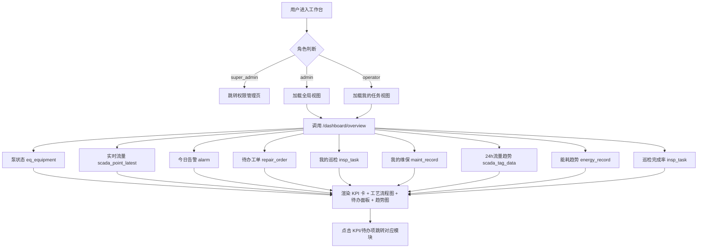

### 20.2 智能助手（AI Chat）对话流程

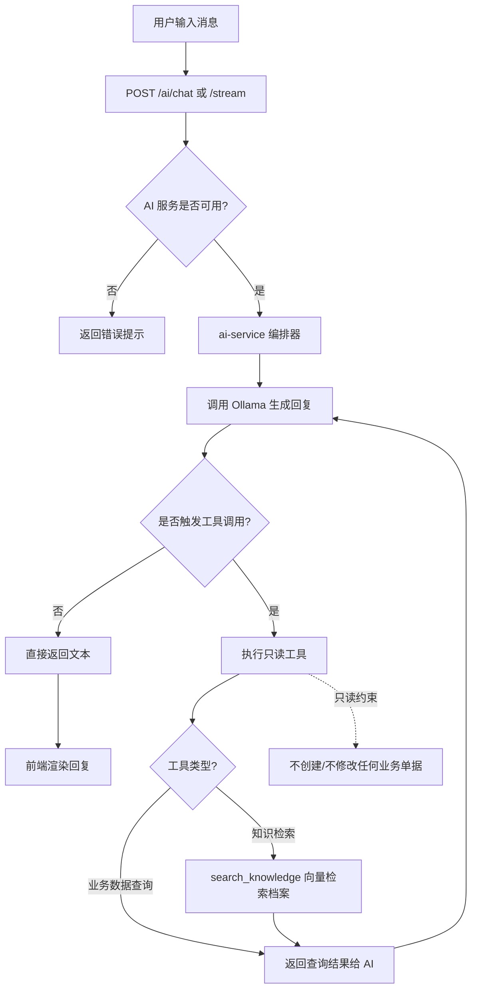

### 20.3 告警中心（Alarm）生成与处理流程

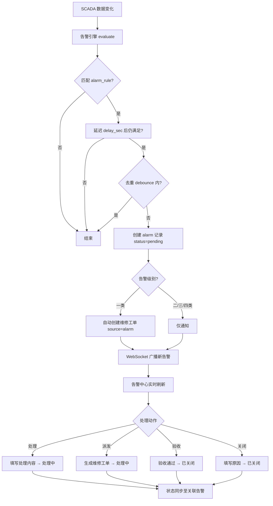

### 20.4 维修工单（Repair）全生命周期

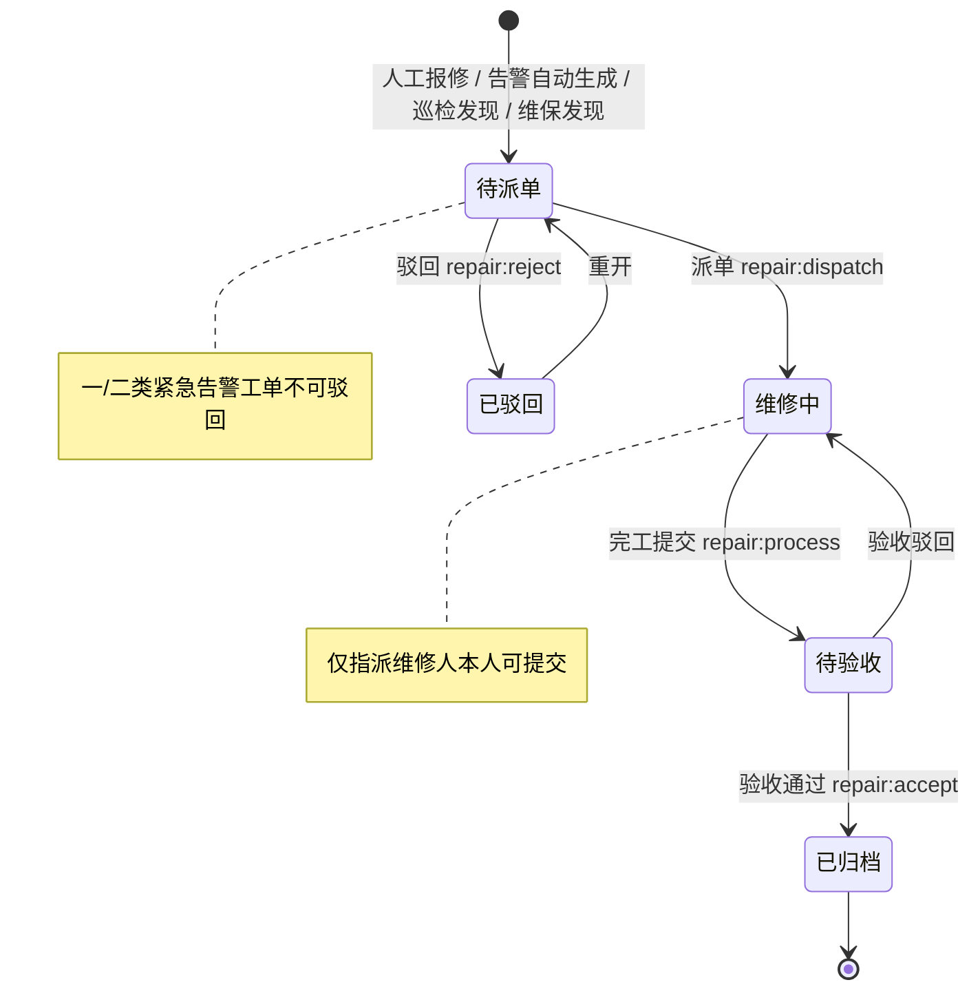

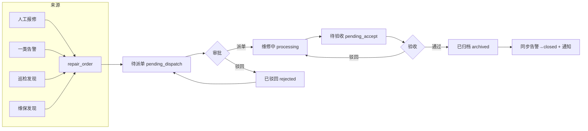

### 20.5 实时监控（SCADA）数据采集流程

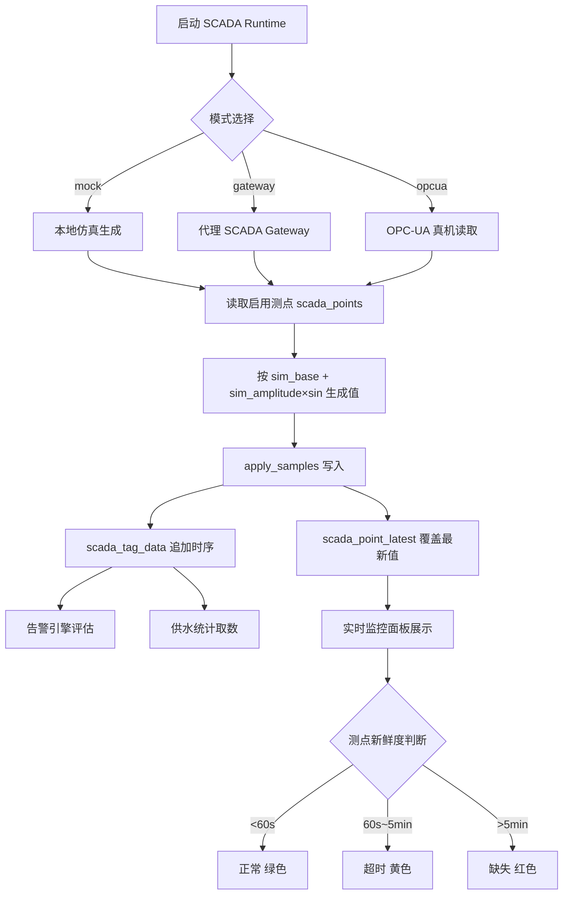

### 20.6 设备资产（Equipment）管理流程

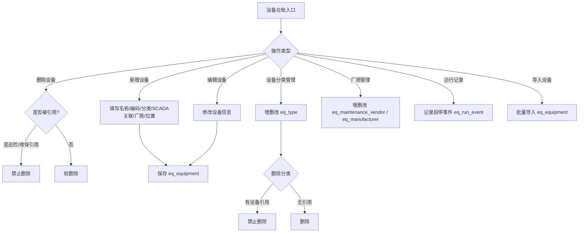

### 20.7 供水分析（Water）数据流程

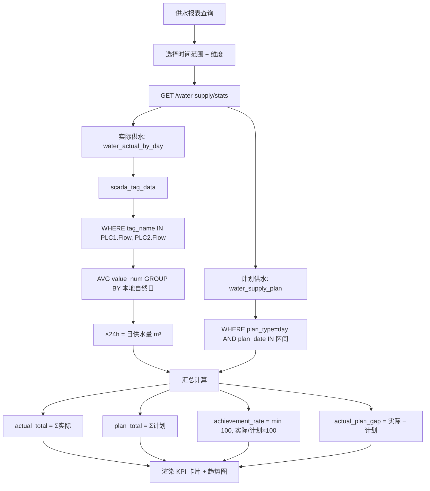

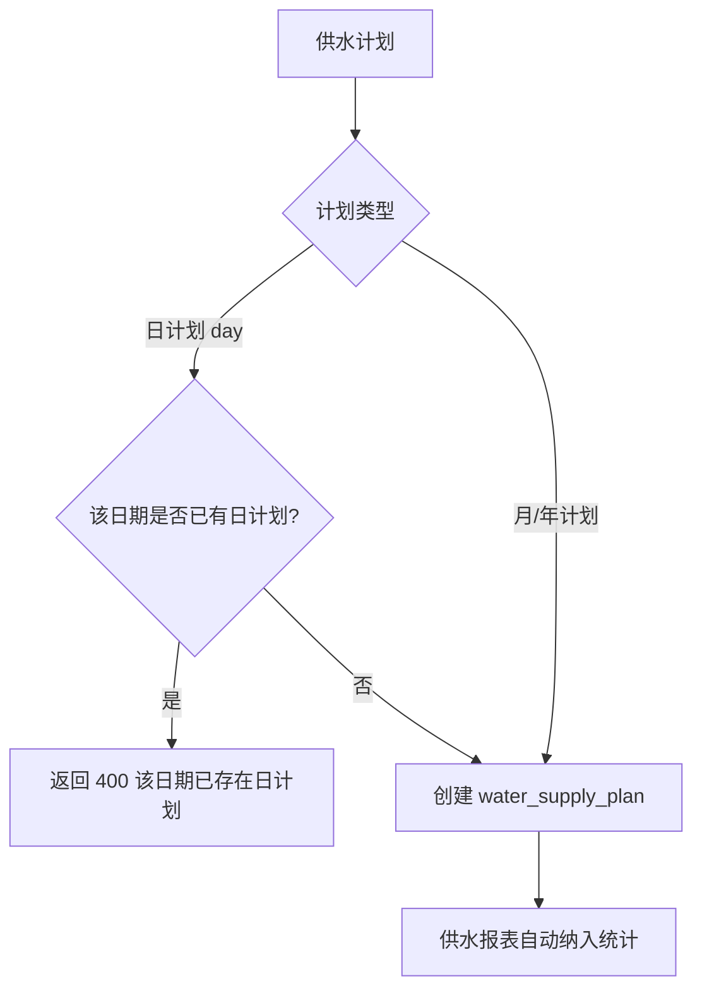

### 20.8 耗能分析（Energy）电费计算流程

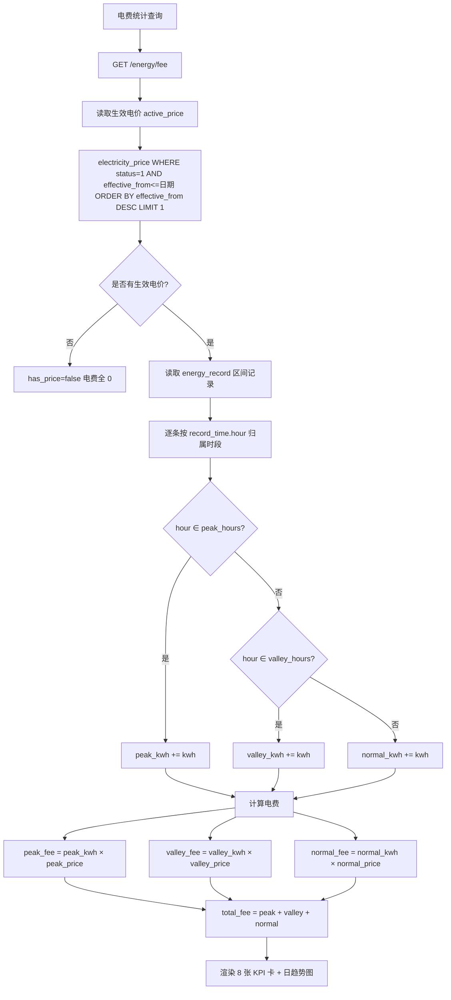

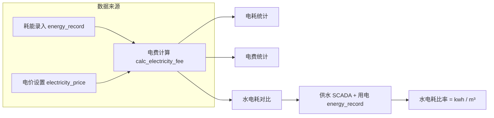

### 20.9 设备巡检（Inspection）闭环流程

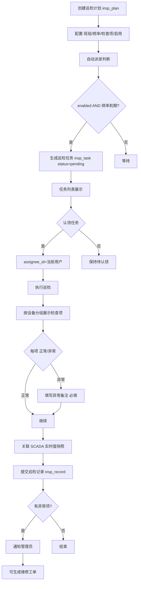

### 20.10 设备维护（Maintenance）闭环流程

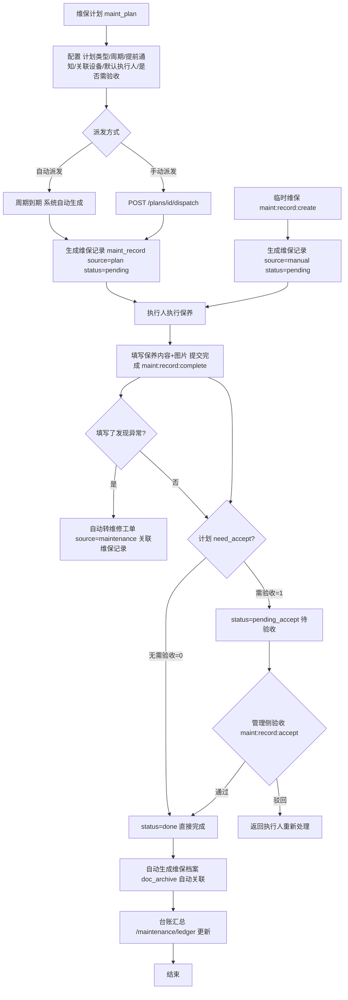

> 维保来源维修工单与维保档案归档相互独立：转工单发生在**提交完成时**（验收前），档案归档发生在**验收通过后**。

### 20.11 档案管理（Archive）流程

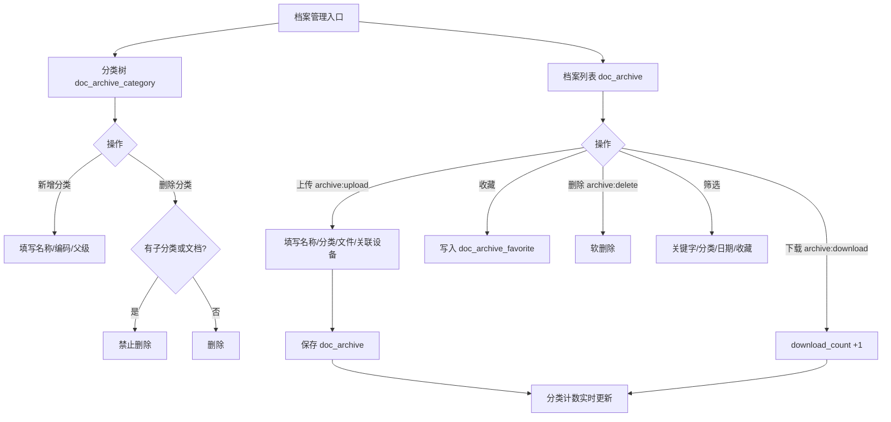

### 20.12 系统管理（System）权限分配流程

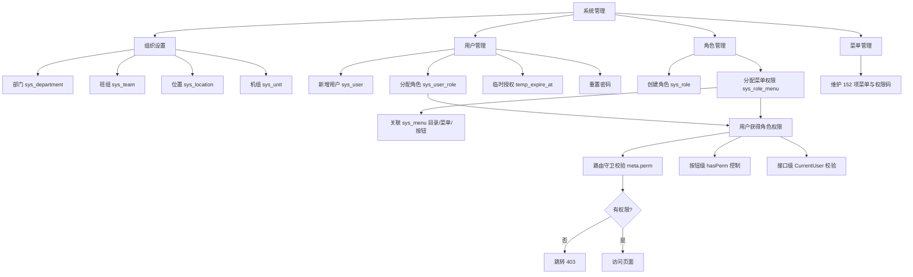

### 20.13 异常页（Exception）触发流程

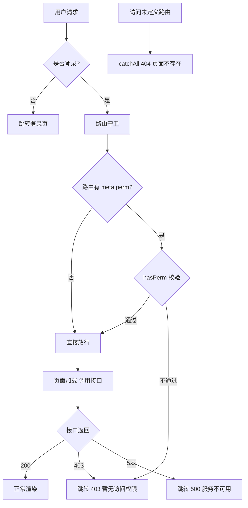

### 20.14 跨模块联动总览

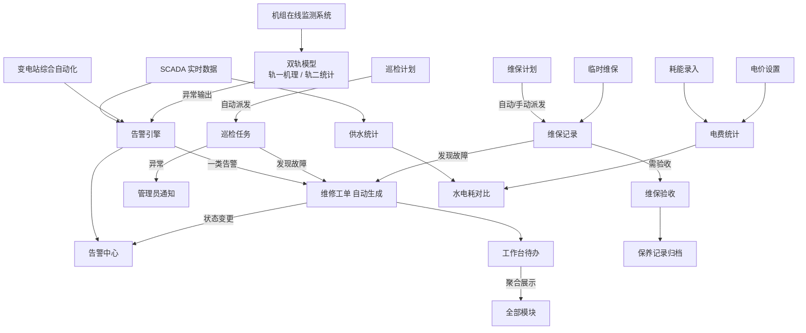

***

## 21. 附录

### 附录 A：数据库表清单（39 张）

| 分类    | 表名                                                                                                                                                              | 用途         |
| :---- | :-------------------------------------------------------------------------------------------------------------------------------------------------------------- | :--------- |
| SCADA | scada\_points, scada\_point\_latest, scada\_tag\_data                                                                                                           | 测点与时序数据    |
| 供水    | water\_supply\_plan                                                                                                                                             | 供水计划       |
| 耗能    | energy\_record, electricity\_price                                                                                                                              | 耗能记录与电价    |
| 告警    | alarm, alarm\_rule, alarm\_type, alarm\_action\_log, alarm\_pending\_state                                                                                      | 告警全链路      |
| 维修    | repair\_order, repair\_action\_log                                                                                                                              | 维修工单与日志    |
| 巡检    | insp\_plan, insp\_task, insp\_record                                                                                                                            | 巡检计划/任务/记录 |
| 维保    | maint\_plan, maint\_plan\_equipment, maint\_record                                                                                                              | 维保计划与记录    |
| 设备    | eq\_equipment, eq\_type, eq\_manufacturer, eq\_maintenance\_vendor, eq\_run\_event                                                                              | 设备台账       |
| 档案    | doc\_archive, doc\_archive\_category, doc\_archive\_favorite                                                                                                    | 档案管理       |
| 系统    | sys\_user, sys\_role, sys\_menu, sys\_role\_menu, sys\_user\_role, sys\_department, sys\_team, sys\_location, sys\_unit, sys\_notification, sys\_operation\_log | 权限与组织      |
| AI    | ai\_audit\_log                                                                                                                                                  | AI 审计      |

### 附录 B：技术栈

| 层级    | 技术                                          |
| :---- | :------------------------------------------ |
| 前端    | Vue 3 + TypeScript + Element Plus + ECharts |
| 后端    | FastAPI + SQLAlchemy + SQLite               |
| SCADA | ScadaRuntime（mock/gateway/opcua）            |
| AI    | ai-service（Ollama + 工具调用）                   |
| 实时通信  | WebSocket（告警广播）                             |

### 附录 C：核心服务文件

| 服务                    | 文件                                           | 职责                              |
| :-------------------- | :------------------------------------------- | :------------------------------ |
| 供水统计                  | analytics\_service.water\_actual\_by\_day    | SCADA 流量→日供水量                   |
| 电费计算                  | analytics\_service.calc\_electricity\_fee    | 峰谷平电费计算                         |
| 电价生效                  | analytics\_service.active\_price             | 生效电价选取                          |
| 告警引擎                  | alarm\_engine.engine                         | 规则评估、告警生成、自动建工单                 |
| 维修状态机                 | repair\_service                              | 工单状态流转、告警同步                     |
| 巡检派发                  | inspection\_service                          | 计划自动派发、执行闭环                     |
| 维保派发                  | maintenance\_service                         | 周期自动派发、验收                       |
| SCADA 仿真              | scada.simulator.ScadaRuntime                 | 测点值生成与写入                        |
| AI 编排                 | ai-service.agent.orchestrator                | 对话与工具调用                         |
| SCADA 网关接入            | services.scada\_ingest                       | 网关数据批量落库                        |
| 点位同步脚本（2026-10-29 新增） | scada-gateway.tools.sync\_points\_from\_main | 主站点位表 → gateway gw\_points 幂等同步 |
| 操作审计                  | middleware.OperationLogMiddleware            | 全请求审计记录                         |

### 附录 D：健康检查

`GET /health`：返回数据库、SCADA 运行时、定时调度器状态，用于部署探活与运维巡检。

**数据来源**：`backend/app/api/health.py`

### 附录 E：修订记录

| 版本   | 日期             | 修订内容                                                                                                                                                                                                                                                                                                                                                                 | 涉及章节                                         |
| :--- | :------------- | :------------------------------------------------------------------------------------------------------------------------------------------------------------------------------------------------------------------------------------------------------------------------------------------------------------------------------------------------------------------- | :------------------------------------------- |
| v1.6 | **2026-10-30** | ①数据统计真实化：供水改按机组有功功率+前后池水位推流（Q=η·P/ρgH，kW→W 修正）、能耗按功率梯形积分、电费按小时电量分峰谷平（兼容 `08:00-11:00` 区间式时段配置）、重建 energy\_record/energy\_efficiency\_daily/water\_supply\_plan；②SCADA 接入可靠性 5 项机制：历史写入节流（his\_rec\_interval 默认 60s）、坏值过滤（非 Good 不写历史不告警）、多站流量分组+单位自适应（\_flow\_to\_m3h）、主站历史 90 天保留清理；③能耗每小时自动重算调度（energy\_stats\_service + ops\_scheduler）；④补充网关 .env 完整配置表          | §8.1、§15.7、附录 E                              |
| v1.5 | **2026-10-29** | ①设备台账页面交互重构：左树新增台数胶囊/圆形图标按钮（新增、导出）、分类 chips、「运行状态｜关联事项」表头、彩色分类图标与状态点、告警铃铛与工单徽标（点击分别切告警 Tab / 跳工单高亮）、树节点去掉「N号机组-」前缀；②详情区状态标签/告警徽标统一 34px 胶囊、待检修与工单跳转改为「全量+单点高亮」、下属设备 6 个/页+「全部设备」浮动面板、设备概况 7 张示意图、告警记录排序、卡片/列表切换仅 >1600px 显示、≤1600px 隐藏概况侧栏、<1440px 操作按钮图标化、列表内滚动与短视口页面滚动；③补齐 SCADA 点位表现状（1,377 点 / 历史 61,824 条 / 4 个流量点无历史）、gateway 真机双通道链路、点位同步脚本与现场联调 6 步、接入自检 SQL | §6.3、§7.2(F-EQ5)、§8.1、§15.1、§15.2、§15.7、附录 C |
| v1.4 | 2026-10-21     | 操作日志页面（双 Tab）、审计详情生成与 180 天保留清理                                                                                                                                                                                                                                                                                                                                      | §1.6、§17                                     |

