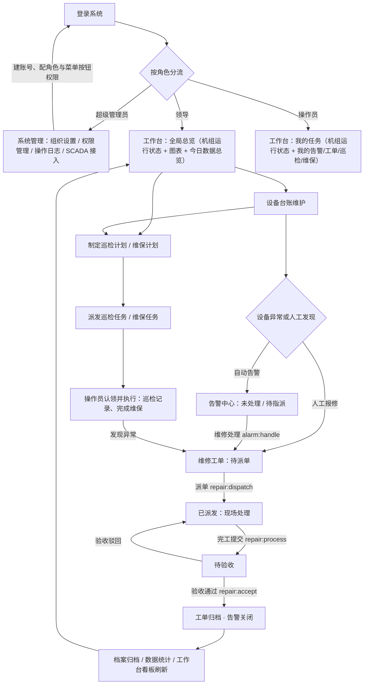

# 新一代泵站运维运营管理平台 · 用户使用手册

| 项目 | 内容 |
|---|---|
| 文档名称 | 新一代泵站运维运营管理平台 用户使用手册 |
| 文档版本 | V1.1 |
| 编制日期 | 2026-10-20（V1.1 修订：2026-11-03） |
| 适用系统版本 | 新一代运管平台（前端 Harbor 主题 / 后端 v1） |
| 适用对象 | 系统管理员、业务领导、一线操作员及项目运维人员 |
| 文档密级 | 内部公开 |

## 修订记录

| 版本 | 日期 | 修订说明 | 编制 |
|---|---|---|---|
| V1.0 | 2026-10-20 | 首版发布，覆盖全部功能模块与角色权限矩阵 | 产品组 |
| V1.1 | 2026-11-03 | 权限细化到按钮级（新增完整按钮权限矩阵）；补充系统业务流程图；按角色重写端到端操作流程；工作台按新版分角色布局更新；移除已下线的「实时监控」「调度指令」章节 | 产品组 |

---

## 目录

1. [系统概述](#1-系统概述)
2. [快速入门](#2-快速入门)
3. [通用交互说明](#3-通用交互说明)
4. [功能模块详解](#4-功能模块详解)
5. [端到端业务流程](#5-端到端业务流程)
6. [常见问题（FAQ）](#6-常见问题faq)
7. [附录](#7-附录)

---

## 1. 系统概述

### 1.1 系统定位

新一代泵站运维运营管理平台是一套面向**泵站（供水/排水泵机组）集中运维与运营**的一体化管理软件。系统以"**设备台账为底座、告警与巡检为感知、维修工单为闭环、数据统计为决策**"为主线，将设备管理、告警处置、巡检、维保、维修、档案与统计分析贯通为一条完整的运维业务链，实现泵站运维的数字化、流程化与可追溯。

### 1.2 主要功能模块

| 序号 | 模块 | 路由入口 | 核心职责 | 可用角色 |
|---|---|---|---|---|
| 1 | 泵站首页总览（工作台） | `/dashboard` | 全局态势、待办任务、机组运行状态与运行动态 | 领导、操作员 |
| 2 | 告警中心 | `/alarm/realtime` | 实时/历史告警监测、处置与规则维护 | 领导、操作员 |
| 3 | 维修工单 | `/repair/list` | 人工报修、派单、完工、验收全流程 | 领导、操作员 |
| 4 | 设备资产 | `/equipment/list`、`/equipment/detail/:id`、`/maintenance/plans`、`/equipment/maintenance-vendors` | 设备台账、设备维护（维保计划）、厂商管理 | 领导、操作员 |
| 5 | 设备巡检 | `/inspection/tasks`、`/inspection/records`、`/inspection/plans` | 巡检计划、任务派发、执行记录 | 领导、操作员 |
| 6 | 数据统计 | `/water/stats`、`/energy/stats` | 供水统计、耗能分析、水电耗对比 | 领导、操作员 |
| 7 | 档案管理 | `/archive` | 各类运维与设备资料的分类归档 | 领导、操作员 |
| 8 | 系统管理 | `/system/departments`、`/system/users`、`/system/logs`、`/system/scada` | 组织架构、用户/角色/菜单权限、操作日志、SCADA 接入 | **仅超级管理员**（操作日志仅领导亦可查看） |
| 9 | 智能助手 | 悬浮入口 → `/ai/chat` | 自然语言问答与辅助操作 | 全部角色 |

### 1.3 用户角色与权限矩阵

系统内置三类角色（`sys_role.code`），角色决定**菜单可见范围、按钮操作权限、数据可见范围**三层差异。**权限以角色为唯一来源**：前端按登录接口下发的权限码控制菜单与按钮显隐，后端对每个写操作接口做同名校验（越权直接返回 403）。

| 维度 | 超级管理员 `super_admin` | 领导 `admin` | 操作员 `operator` |
|---|---|---|---|
| 系统定位 | 系统配置与账号运维 | 全局业务管理与审批 | 一线任务执行 |
| 菜单可见 | **仅「系统管理」**：组织设置、权限管理、操作日志、SCADA 接入 | 全部业务菜单 + 操作日志 | 全部业务菜单（不含系统管理） |
| 进入后落地页 | 权限管理（工作台不开放） | 工作台（全局总览） | 工作台（我的任务） |
| 按钮权限 | 全部 `sys:*` 按钮 | 全部业务按钮（不含 `sys:*`） | 仅执行/上报表单类按钮（见下表） |
| 数据范围 `data_scope` | `all`（全部） | `all`（全部） | `mine`（仅本人/本班组） |

#### 菜单可见矩阵

| 菜单 | 超级管理员 | 领导 | 操作员 |
|---|:--:|:--:|:--:|
| 工作台 `/dashboard` | — | ✓ | ✓ |
| 告警中心 `/alarm/realtime` | — | ✓ | ✓ |
| 维修工单 `/repair/list` | — | ✓ | ✓ |
| 设备资产（台账 / 维护 / 厂商） | — | ✓ | ✓ |
| 设备巡检 | — | ✓ | ✓ |
| 数据统计（供水 / 耗能） | — | ✓ | ✓ |
| 档案管理 `/archive` | — | ✓ | ✓ |
| 系统管理 · 组织设置 | ✓ | — | — |
| 系统管理 · 权限管理 | ✓ | — | — |
| 系统管理 · 操作日志 | ✓ | ✓ | — |
| 系统管理 · SCADA 接入 | ✓ | — | — |
| 智能助手（悬浮入口） | ✓ | ✓ | ✓ |

#### 按钮级权限矩阵（默认授权）

> 图例：✓ 默认拥有；— 默认不拥有（可在「权限管理 → 角色管理」中按需调整）。"仅本人"表示还需满足数据归属条件。

| 模块 | 按钮 / 操作 | 权限码 | 超管 | 领导 | 操作员 |
|---|---|---|:--:|:--:|:--:|
| 工作台 | 进入工作台 | `dashboard:view` | — | ✓ | ✓ |
| 告警中心 · 实时/历史 | 维修处理（一键转维修工单） | `alarm:handle` | — | ✓ | ✓ |
| 告警中心 · 告警规则 | 新增规则 / 复制规则 | `alarm:rule:create` | — | ✓ | — |
| 告警中心 · 告警规则 | 编辑规则 | `alarm:rule:update` | — | ✓ | — |
| 告警中心 · 告警规则 | 删除规则 | `alarm:rule:delete` | — | ✓ | — |
| 告警中心 · 告警类型 | 新增 / 编辑 / 删除类型 | `alarm:type:create` / `alarm:type:update` / `alarm:type:delete` | — | ✓ | — |
| 维修工单 | 人工报修 | `repair:create` | — | ✓ | ✓ |
| 维修工单 | 派单 | `repair:dispatch` | — | ✓ | — |
| 维修工单 | 驳回 | `repair:reject` | — | ✓ | — |
| 维修工单 | 完工提交 | `repair:process` | — | ✓ | ✓（仅本人处理） |
| 维修工单 | 验收 | `repair:accept` | — | ✓ | — |
| 设备台账 | 新增设备 | `eq:create` | — | ✓ | — |
| 设备台账 | 编辑设备 | `eq:update` | — | ✓ | — |
| 设备台账 | 删除设备 | `eq:delete` | — | ✓ | — |
| 设备台账 | 设备行内「报修」 | `repair:create` | — | ✓ | ✓ |
| 设备台账 · 设备分类 | 新增 / 编辑 / 删除分类 | `eq:type:create` / `eq:type:update` / `eq:type:delete` | — | ✓ | — |
| 设备台账 · 运行记录 | 记录启停 | `eq:run:event` | — | ✓ | ✓ |
| 设备维护 · 维保计划 | 新增计划 | `maint:plan:create` | — | ✓ | ✓ |
| 设备维护 · 维保计划 | 手动派发 | `maint:plan:create` | — | ✓ | ✓ |
| 设备维护 · 维保计划 | 编辑计划 | `maint:plan:update` | — | ✓ | — |
| 设备维护 · 维保计划 | 删除计划 | `maint:plan:delete` | — | ✓ | — |
| 设备维护 · 维保记录 | 临时维保 | `maint:record:create` | — | ✓ | — |
| 设备维护 · 维保记录 | 完成维保 | `maint:record:complete` | — | ✓ | ✓ |
| 设备维护 · 维保记录 | 维保验收 | `maint:record:accept` | — | ✓ | — |
| 厂商管理 | 维保厂商 增 / 改 / 删 | `eq:maintainer:create` / `eq:maintainer:update` / `eq:maintainer:delete` | — | ✓ | — |
| 厂商管理 | 生产厂商 增 / 改 / 删 | `eq:mfr:create` / `eq:mfr:update` / `eq:mfr:delete` | — | ✓ | — |
| 设备巡检 · 任务 | 派发巡检任务 | `insp:task:create` | — | ✓ | — |
| 设备巡检 · 任务 | 认领并执行 / 执行巡检 | `insp:task:claim` + `insp:record:submit` | — | ✓ | ✓ |
| 设备巡检 · 记录 | 提交巡检记录 | `insp:record:submit` | — | ✓ | ✓ |
| 设备巡检 · 记录 | 异常转「人工报修」 | `repair:create` | — | ✓ | ✓ |
| 设备巡检 · 巡检计划 | 新增 / 编辑 / 删除计划 | `insp:plan:create` / `insp:plan:update` / `insp:plan:delete` | — | ✓ | — |
| 数据统计 · 供水计划 | 新增 / 编辑 / 删除 | `water:plan:create` / `water:plan:update` / `water:plan:delete` | — | ✓ | — |
| 数据统计 · 耗能录入 | 新增 / 编辑 / 删除 | `energy:record:create` / `energy:record:update` / `energy:record:delete` | — | ✓ | — |
| 数据统计 · 电价设置 | 新增 / 编辑 / 删除 | `energy:price:create` / `energy:price:update` / `energy:price:delete` | — | ✓ | — |
| 档案管理 | 上传文档 | `archive:upload` | — | ✓ | — |
| 档案管理 | 下载档案 | `archive:download` | — | ✓ | ✓ |
| 档案管理 | 删除档案 | `archive:delete` | — | ✓ | — |
| 档案管理 · 分类 | 新增 / 编辑 / 删除分类 | `archive:category:create` / `archive:category:update` / `archive:category:delete` | — | ✓ | — |
| 系统管理 · 组织设置 | 新增 / 编辑 / 删除组织、班组 | `sys:dept:create` / `sys:dept:update` / `sys:dept:delete` | ✓ | — | — |
| 系统管理 · 用户管理 | 新增 / 编辑 / 删除用户 | `sys:user:create` / `sys:user:update` / `sys:user:delete` | ✓ | — | — |
| 系统管理 · 角色管理 | 新增 / 编辑 / 删除角色、分配权限 | `sys:role:assign` | ✓ | — | — |
| 系统管理 · 菜单管理 | 维护菜单与权限标识 | `sys:menu:manage` | ✓ | — | — |
| 系统管理 · SCADA 接入 | 接入参数配置 | `sys:scada:config` | ✓ | — | — |

**说明：**

- **页面访问权限**与「菜单权限码」一一对应（如 `eq:list`、`repair:list`），无权限直接跳转 403 页。
- **通用操作不受权限控制**：列表的搜索、筛选、分页、刷新、列设置、导出、详情抽屉、跨页定位等，所有已登录用户均可用。
- **操作员的数据范围**为 `mine`：工单仅本人被指派的、巡检/维保仅本人认领或派发的、告警仅本人相关；列表因此出现"看不到别人的数据"属正常现象。
- **超级管理员不再使用通配 `*`**：其 `sys:*` 权限为逐项授权，且不包含任何业务菜单/按钮；如需临时查看业务功能，请在角色管理中为其勾选对应权限。
- 用户额外获得的"临时授权"按钮权限会叠加在角色权限之上，有效期结束后自动失效。

### 1.4 系统业务流程图

下图为主线流程：**登录分流 → 台账/计划 → 任务执行 → 异常告警 → 派单维修 → 验收归档 → 数据回流看板**。

**阅读说明：**

- 箭头代表业务状态的流转；箭头标签上的文字为触发该流转的**操作与权限码**（如 `派单 repair:dispatch`）。
- 「告警 → 维修工单」有两条入口：自动告警在**告警中心**点「维修处理」一键转单；人工发现异常可直接在**维修工单**或**设备台账**发起「人工报修」。
- 巡检、维保发现异常时，同样走「人工报修」进入维修闭环。
- 系统管理只负责账号与权限配置，不参与业务流转；配置生效后，相关账号重新登录即可看到新菜单与按钮。

### 1.5 运行环境与访问方式

- **访问方式**：浏览器（推荐 Chrome / Edge 最新版）访问系统部署地址，登录后进入。
- **显示适配**：桌面端为最佳体验（建议分辨率 ≥ 1440×900）；窄屏（≤1024px）侧边栏自动收起为图标栏；移动端各列表与卡片自动切换为响应式单列排布。
- **账号来源**：账号由超级管理员在「系统管理 → 权限管理 → 用户管理」中创建并分配角色。

---

## 2. 快速入门

### 2.1 登录

1. 打开系统访问地址，进入登录页。
2. 输入**用户名**与**密码**（登录页默认预填演示账号，正式环境请勿使用默认凭据）。
3. 点击「登 录」（输入框内按回车同样可提交）。
4. 登录成功后自动跳转：
   - 领导、操作员 → 跳转至 **泵站首页总览**；
   - 超级管理员 → 直接进入 **权限管理**（工作台对其不开放）。

> **提示**：若从受保护页面被重定向到登录页，登录后会**自动回到原访问地址**。

### 2.2 退出登录

点击右上角**头像**，在弹出卡片中点击「**退出登录**」，系统清除本地登录态并返回登录页。

### 2.3 界面总览

| 区域 | 位置 | 说明 |
|---|---|---|
| 侧边导航栏 | 左侧 | 按当前角色显示可访问菜单，支持逐级展开；顶部 Logo 点击可回到默认首页 |
| 折叠按钮 | 左上角 | 切换侧边栏展开/收起 |
| 页面标题 | 顶栏中部 | 显示当前页面名称 |
| 实时时钟 | 顶栏右侧 | 显示年月日、星期与实时时间 |
| 全屏按钮 | 顶栏右侧 | 切换浏览器全屏显示 |
| 通知铃铛 | 顶栏右侧 | 显示未读通知数量，点击查看通知列表、支持"全部已读"与跳转定位 |
| 用户菜单 | 顶栏右侧头像 | 显示当前用户姓名/账号，提供退出登录 |
| 智能助手 | 右下角悬浮球 | 点击展开智能问答面板 |

---

## 3. 通用交互说明

各模块列表与表单遵循统一交互规范，掌握后即可快速上手所有页面。

### 3.1 搜索与筛选

- **搜索栏**：位于页面顶部，支持按关键字（名称/编号等）、下拉选项、日期等条件组合查询；点击「查询」执行，点击「重置」清空条件。
- **快捷统计卡（KPI 卡）**：多数列表页顶部设有统计卡（如设备总数、在线、待检修等）。**点击卡片可按该状态快捷筛选列表，再次点击取消筛选**。
- **Tab 页签**：模块内多视图通过顶部页签切换；页签按权限动态显示（无对应权限的页签不渲染）。

### 3.2 表格通用操作

| 操作 | 说明 |
|---|---|
| 列显隐 | 通过表格右上角"列设置"勾选需要显示的列 |
| 导出 | 点击「导出」将当前数据导出为 Excel（文件名按模块命名） |
| 刷新 | 点击「刷新」重新拉取最新数据 |
| 分页 | 底部支持切换每页条数（默认 20 条）与翻页 |
| 行操作 | 每行右侧提供"详情/编辑/删除"等按钮，按钮按权限显隐 |

### 3.3 详情抽屉

点击列表中的「详情 / 查看」按钮，从**右侧滑出详情抽屉**，集中展示该条记录的完整信息（如设备、工单、告警、计划等）；部分抽屉底部提供当前可执行的操作按钮。

### 3.4 表单弹窗

新增/编辑操作均以**居中弹窗**呈现，带字段校验；校验不通过时字段下方出现红色提示，提交失败时顶部给出错误消息。

### 3.5 跨页定位与高亮

部分入口支持**带参跳转并高亮定位**：例如在首页机组信息面板点击「查看详情」后，跳转至设备台账页会自动筛选并高亮对应设备行；工作台待办点击后跳转到对应模块并定位。命中行以浅蓝底 + 左侧蓝色竖条标记。

### 3.6 消息提示

操作结果（成功/失败/警告）以顶部消息条提示；右上角铃铛集中展示与当前用户相关的通知，点击通知可跳转至关联业务页面。

---

## 4. 功能模块详解

### 4.1 泵站首页总览（工作台）

**功能概述**：系统门户，按角色呈现两套布局——领导为**全局总览**，操作员为**我的任务**。

**领导视图（全局总览）**：

- **左列**：上部为**机组运行状态**通栏工艺图（5 台机组，徽章显示"运行中/停止"），下部为 2×2 图表：供水量·计划对比、电耗·吨水电耗、前后池水位、能耗趋势（能耗趋势支持日/周切换）。
- **右列**：综合告警、待处理工单、近 7 日供水量。
- **今日数据总览窄栏**（最右侧）：今日供水/用电/告警/工单 4 张指标卡 → 能耗概览（电费、峰谷平电量环图、电价参考、吨水电耗、计划完成率）→ 机组运行时长排行 → 机组能效排行（单耗 kWh/m³）→ 告警/工单概览 → **日期日历**（点击历史日期，整页切换为该日数据）。

**操作员视图（我的任务）**：

- **上**：**机组运行状态**通栏工艺图（图片自适应铺满，5 台机组徽章横向对齐机组正上方）。
- **下**：一行四张待办卡——**我的告警 / 我的待办工单 / 我的待办巡检 / 我的待办维保**，均只列本人数据，卡片内「更多」可跳转对应模块并自动带上本人筛选条件。

**机组运行状态（两角色通用操作）**：

1. 点击任一机组徽章 → 弹出该机组信息面板（不再遮挡被选机组）。
2. 面板内容：① 运行状态心电图与运行/停止 ② 台账信息（设备编号、类型）③ 实时工况（运行电流、有功功率、轴承温度、本次运行时长）④ 运维情况（未闭环工单、未闭环告警）。
3. 面板底部「**查看详情**」→ 跳转设备台账并自动定位、高亮该设备。
4. 点击面板以外区域或面板右上角关闭按钮收起。

**权限与可见范围**：领导呈现全局数据（`all`）；操作员呈现本人数据（`mine`）。本页仅对领导与操作员开放，超级管理员不进入（登录后直达权限管理）。

---

### 4.2 告警中心

**功能概述**：集中监测泵站设备实时/历史告警，并完成告警的指派与处置闭环。

**页面构成与页签**：

- **实时告警**（默认）：当前活跃告警列表；
- **历史告警**：已处置告警归档查询；
- **告警规则** / **告警类型**（**仅具备 `alarm:rule:*` / `alarm:type:*` 权限时显示**）：告警判定规则与分类维护。

**主要表格列**：规则/设备、告警等级、告警内容、设备、位置、触发值、状态、指派、时间、操作。

**告警等级**（`alarm_level`）：

| 等级 | 中文 | 颜色 |
|---|---|---|
| 1 | 一类 | 红 |
| 2 | 二类 | 橙 |
| 3 | 三类 | 蓝 |

**告警状态**（`alarm_status`）：

| 状态码 | 中文 | 说明 |
|---|---|---|
| `pending` | 未处理 | 已产生、已关联工单但尚未处理 |
| `processing` | 处理中 | 已派工、维修处理中 |
| `pending_accept` | 待验收 | 维修完成，等待验收 |
| `closed` | 已关闭 | 已验收关闭 |
| （派生）未闭环且无关联工单 | **待指派** | 展示层按"未关联维修工单"细分显示 |

**快捷统计卡**：未处理 / 处理中 / 待指派 / 全部数据（点击筛选）。其中"未处理""处理中"卡为对应状态且已派工；"待指派"卡为未闭环且未关联工单。

**主要操作与权限**：

| 按钮 | 权限码 | 领导 | 操作员 | 说明 |
|---|:--:|:--:|:--:|---|
| 维修处理 | `alarm:handle` | ✓ | ✓ | 将未处理/待指派告警一键转为维修工单（唯一的处置入口） |
| 新增规则 / 复制规则 | `alarm:rule:create` | ✓ | — | 规则维护（复制以现有规则为模板快速新建） |
| 编辑规则 | `alarm:rule:update` | ✓ | — | 规则维护 |
| 删除规则 | `alarm:rule:delete` | ✓ | — | 规则维护 |
| 新增/编辑/删除告警类型 | `alarm:type:create` / `alarm:type:update` / `alarm:type:delete` | ✓ | — | 类型维护 |

**操作步骤（处置一条告警）**：

1. 进入「告警中心 → 实时告警」，按等级/状态筛选目标告警。
2. 点击行内「**维修处理**」→ 系统生成一张关联该告警的维修工单，工单处理人默认指给当前操作人。
3. 生成后前往「维修工单」继续派单/完工流程（告警状态随工单进度自动联动：未处理 → 处理中 → 待验收 → 已关闭）。
4. 无需处理的误报，可在「历史告警」中查看其闭环记录。

**数据范围**：操作员默认只看"派给我/我相关的告警"（`mine`），领导查看全部。

---

### 4.3 维修工单

**功能概述**：承载设备故障的**人工报修与自动转单**，并完成派单、完工、验收的全流程闭环。

**页面构成**：

- **KPI 统计卡**：待派单 / 已派发 / 待验收 / 已归档 / 已驳回（点击筛选）。
- **查询条件**：工单号、设备名称、状态。

**主要表格列**：工单编号、设备名称、故障描述、处理状态、处理人、时间、操作。

**工单状态**（`process_status`）：

| 状态码 | 中文 | 颜色 |
|---|---|---|
| `pending_dispatch` | 待派单 | 蓝 |
| `processing` | 已派发 | 橙 |
| `pending_accept` | 待验收 | 紫 |
| `archived` | 已归档 | 绿 |
| `rejected` | 已驳回 | 灰 |

**主要操作与权限**：

| 按钮 | 权限码 | 领导 | 操作员 | 触发条件 | 说明 |
|---|---|:--:|:--:|---|---|
| 人工报修 | `repair:create` | ✓ | ✓ | 任意 | 新建工单，填写设备、故障描述、紧急程度、现场照片 |
| 派单 | `repair:dispatch` | ✓ | — | 待派单 | 指派处理人员并填写派单说明 |
| 驳回 | `repair:reject` | ✓ | — | 待派单 | 驳回并填写驳回意见 |
| 完工提交 | `repair:process` | ✓ | ✓ | 已派发且处理人为本人 | 填写处理过程与结果，提交后进入待验收 |
| 验收 | `repair:accept` | ✓ | — | 待验收 | 查看维修完成情况（含图片）后验收通过或驳回返工 |

**流程说明**：验收通过后工单**自动归档**；验收驳回则退回维修人员返工；操作员只能对自己被指派的工单点「完工提交」。

**数据范围**：操作员默认为"我的工单"（`mine`），仅可见本人相关工单。

---

### 4.4 设备资产

设备资产模块由三部分构成：**设备台账**、**设备维护（维保计划）**、**厂商管理**。

#### 4.4.1 设备台账（`/equipment/list`，权限 `eq:list`）

**页面构成**：KPI 统计卡（设备总数 / 在线 / 待检修 / 故障 / 检修中等）、搜索栏、设备列表；页签含「设备列表」「设备分类」「运行记录」（后两者按 `eq:type:*` / `eq:run:event` 权限显示）。

**设备列表主要列**：设备名称、设备编号、设备分类、部署位置、运行状态、维护状态、操作。

**运行状态**：`running` 运行中 / `stopped` 已停机。
**维护状态**：`normal` 正常 / `need_maintain` 需保养 / `fault` 故障待修。
**派生检修状态**：`pending` 待检修（橙，由未闭环维修工单投影）/ `overhaul` 检修中（紫）。

**新增/编辑表单字段**：设备名称、设备编号、设备分类、部署位置、关联变量ID（SCADA 测点 ID，逗号分隔）、生产厂商、维保厂商、维保期限（天）、运行状态、维护状态、连续运行小时、生产日期、采购日期、首次运行日期、备注。

**主要操作与权限**：

| 按钮 | 权限码 | 领导 | 操作员 |
|---|---|:--:|:--:|
| 新增设备 | `eq:create` | ✓ | — |
| 编辑设备 | `eq:update` | ✓ | — |
| 删除设备 | `eq:delete` | ✓ | — |
| 设备行内「报修」 | `repair:create` | ✓ | ✓ |
| 设备分类 增/改/删 | `eq:type:create` / `eq:type:update` / `eq:type:delete` | ✓ | — |
| 记录启停 | `eq:run:event` | ✓ | ✓ |

**设备分类**：通过简单 CRUD 维护，列含分类名称、分类代码、描述、状态。
**运行记录**：展示当前设备状态、累计运行时长、启停统计及运行记录明细，「记录启停」弹窗用于手工登记启停事件。
**操作员视角**：只读台账与分类，可对设备发起「报修」、在运行记录中登记启停。

#### 4.4.2 设备维护（`/maintenance/plans`，权限 `maint:plan:list`）

**功能概述**：以**维保计划**驱动定期维护，并完成派发、执行、验收。

**页面构成**：搜索栏、维保计划列表；计划详情含周期、关联设备、执行人、启用状态、派发与验收情况，并提供「维保记录」「台账汇总」子页。

**新增/编辑表单字段**：计划名称、计划类型、开始时间、周期、提前通知、关联设备、默认执行人、是否启用、是否需验收。

**主要操作与权限**：

| 按钮 | 权限码 | 领导 | 操作员 |
|---|---|:--:|:--:|
| 新增计划 | `maint:plan:create` | ✓ | ✓ |
| 手动派发 | `maint:plan:create` | ✓ | ✓ |
| 编辑计划 | `maint:plan:update` | ✓ | — |
| 删除计划 | `maint:plan:delete` | ✓ | — |
| 临时维保 | `maint:record:create` | ✓ | — |
| 完成维保 | `maint:record:complete` | ✓ | ✓ |
| 维保验收 | `maint:record:accept` | ✓ | — |

**数据范围**：操作员默认为"我的维保"（`mine`）。

#### 4.4.3 厂商管理（`/equipment/maintenance-vendors`，权限 `eq:maintainer:list`）

**页面构成**：页签「维保厂商」「生产厂商」；维保厂商列含厂商名称、企业代码、联系人、联系电话、地址、状态。

**主要操作与权限**：

| 按钮 | 权限码 | 领导 | 操作员 |
|---|---|:--:|:--:|
| 维保厂商 增/改/删 | `eq:maintainer:create` / `eq:maintainer:update` / `eq:maintainer:delete` | ✓ | — |
| 生产厂商 增/改/删 | `eq:mfr:create` / `eq:mfr:update` / `eq:mfr:delete` | ✓ | — |

**数据范围**：操作员为**只读**查看。

---

### 4.5 设备巡检

**功能概述**：以**巡检计划**生成**巡检任务**，由执行人现场巡检并提交**巡检记录**，异常可转化为维修工单。

**页面构成与页签**：巡检任务 / 巡检记录（默认），加「巡检计划」（**仅具备 `insp:plan:*` 权限时显示**）。

**巡检任务主要列**：序号、计划、班组、任务日期、巡检设备、任务状态、认领人、操作。

**任务状态**（`task_status` 及派生展示）：

| 状态 | 展示 | 颜色 |
|---|---|---|
| `pending` 且未认领 | 待认领 | 橙 |
| `pending` 且已认领 | 待巡检（进行中） | 蓝 |
| `overdue` | 已超时 N 天 | 红 |
| `done` | 已完成 | 绿 |

**执行流程**：在任务行点击「执行巡检 / 认领并执行」→ 打开「执行巡检任务」弹窗 → 按设备分组逐项填写检查结果（正常/异常）与备注 → 提交总体备注完成记录。

**主要操作与权限**：

| 按钮 | 权限码 | 领导 | 操作员 |
|---|---|:--:|:--:|
| 派发巡检 | `insp:task:create` | ✓ | — |
| 认领并执行 / 执行巡检 | `insp:task:claim` + `insp:record:submit` | ✓ | ✓ |
| 提交记录 | `insp:record:submit` | ✓ | ✓ |
| 异常转「人工报修」 | `repair:create` | ✓ | ✓ |
| 新增/编辑/删除计划 | `insp:plan:create` / `insp:plan:update` / `insp:plan:delete` | ✓ | — |

**说明**：操作员默认停留在「巡检任务」页签，无「巡检计划」页签（计划属管理职能）。

---

### 4.6 数据统计

#### 4.6.1 供水统计（`/water/stats`，权限 `water:stats`）

**页面构成**：页签「供水报表」「供水计划」「供水对比」；含搜索栏、KPI 统计卡、图表区与明细。按时间/机组维度展示折线图与柱状图，并给出实际/计划汇总。

**主要操作与权限**：

| 按钮 | 权限码 | 领导 | 操作员 |
|---|---|:--:|:--:|
| 新增/编辑/删除供水计划 | `water:plan:create` / `water:plan:update` / `water:plan:delete` | ✓ | — |

#### 4.6.2 耗能分析（`/energy/stats`，权限 `energy:stats`）

**页面构成**：页签「电耗统计」「电费统计」「水电耗对比」「耗能录入」「电价设置」。

**电耗统计表格列**：时间、用电量、用水量、水电耗；图表按日/机组维度展示能耗趋势。

**主要操作与权限**：

| 按钮 | 权限码 | 领导 | 操作员 |
|---|---|:--:|:--:|
| 耗能录入 增/改/删 | `energy:record:create` / `energy:record:update` / `energy:record:delete` | ✓ | — |
| 电价设置 增/改/删 | `energy:price:create` / `energy:price:update` / `energy:price:delete` | ✓ | — |

**数据范围**：操作员为**只读**查看。

---

### 4.7 档案管理

**功能概述**：对运维记录、设备资料、技术资料、合同文件等文档进行**分类归档、上传、下载与检索**。

**页面构成**：顶部档案总数与分类统计卡；左侧**分类树**（支持新增/编辑/删除分类）；右侧档案列表（查看、下载、删除）。上传文档弹窗含：文档名称、文档类型、选择文件、备注。

**内置档案分类**（示例）：运维记录（告警/巡检/维保/人工创建工单）、设备资料（说明书/图纸/技术参数）、技术资料（规范/方案/维护手册）、合同文件（采购合同/服务协议）、其他资料。

**主要操作与权限**：

| 按钮 | 权限码 | 领导 | 操作员 |
|---|---|:--:|:--:|
| 上传文档 | `archive:upload` | ✓ | — |
| 档案分类 增/改/删 | `archive:category:create` / `archive:category:update` / `archive:category:delete` | ✓ | — |
| 删除档案 | `archive:delete` | ✓ | — |
| 下载档案 | `archive:download` | ✓ | ✓ |

**数据范围**：操作员为**查看/下载**（`archive:list` + `archive:download`）。

---

### 4.8 系统管理（仅超级管理员）

> 领导可额外看到「操作日志」页签用于审计查询，其余页面仅超级管理员可见。

#### 4.8.1 组织设置（`/system/departments`，权限 `sys:dept:list`）

维护**部门/组织架构**。部门管理列含：部门名称、部门编码、备注、状态。

**主要操作与权限**：新增/编辑/删除组织（`sys:dept:create/update/delete`）。

#### 4.8.2 权限管理（`/system/users`，权限 `sys:user:list`）

**页面构成**：页签「用户管理」「角色管理」「菜单管理」。

- **用户管理**：列含用户名、姓名、手机、部门、班组、关联角色、状态、临时授权、操作。支持搜索、新增、编辑、临时授权、删除、导出。
- **角色管理**：维护角色名称、编码、数据范围（`all`/`mine`）及所绑定的菜单与按钮权限。
- **菜单管理**：维护系统菜单结构与权限标识。

**主要操作与权限**：

| 按钮 | 权限码 |
|---|---|
| 新增/编辑/删除用户 | `sys:user:create` / `sys:user:update` / `sys:user:delete` |
| 分配角色 | `sys:role:assign` |
| 菜单管理 | `sys:menu:manage` |
| 组织 增/改/删 | `sys:dept:create` / `sys:dept:update` / `sys:dept:delete` |
| SCADA 接入配置 | `sys:scada:config` |

**角色权限配置流程**：新建/选择角色 → 勾选该角色可见的菜单与按钮权限 → 保存 → 用户分配该角色后，登录即按新权限刷新菜单与按钮。

> **注意**：权限配置**以角色为唯一权威来源**。修改角色权限后，对应账号需重新登录（或切回标签页触发刷新）方可生效。

---

### 4.9 智能助手

**功能概述**：右下角悬浮球入口，打开自然语言对话面板，用于查询信息、辅助定位与业务问答。

**访问权限**：所有登录用户均可使用。

---

## 5. 端到端业务流程

> 每一步都标注「谁来做、在哪个页面、点哪个按钮、操作后状态如何变化」，可直接作为岗位作业指导书使用。

### 5.1 告警处置闭环

**参与角色**：操作员（处置）、领导（派单/验收）。

| 步骤 | 角色 | 页面 / 按钮 | 关键填写 | 状态变化 |
|---|---|---|---|---|
| 1 | 系统 | 告警中心 · 实时告警 | 自动产生 | — → **未处理** |
| 2 | 操作员 / 领导 | 实时告警 → 行内「维修处理」`alarm:handle` | 确认设备、故障描述（可带现场照片） | 告警 **未处理 → 处理中**，同时生成维修工单（待派单） |
| 3 | 领导 | 维修工单 → 「派单」`repair:dispatch` | 处理人、派单说明、期限 | 工单 **待派单 → 已派发** |
| 4 | 操作员（被指派人） | 维修工单 → 「完工提交」`repair:process` | 处理过程、处理结果、完工照片 | 工单 **已派发 → 待验收** |
| 5 | 领导 | 维修工单 → 「验收」`repair:accept` | 验收结论（通过 / 驳回返工） | 通过 → **已归档** + 告警 **已关闭**；驳回 → 退回 **已派发** |

**分支说明**：

- 误报或无需维修：不转工单，保持「**待指派**」（未闭环且未关联工单），在历史告警中可查；
- 工单被驳回（`repair:reject`）后状态为「已驳回」，需重新发起报修。

### 5.2 人工报修闭环

**参与角色**：任何人可报修，领导派单/验收，操作员完工。

| 步骤 | 角色 | 页面 / 按钮 | 关键填写 | 状态变化 |
|---|---|---|---|---|
| 1 | 操作员 / 领导 | 维修工单 → 「人工报修」`repair:create`（或设备台账行内「报修」） | 设备、故障描述、紧急程度、照片 | 新建 → **待派单** |
| 2 | 领导 | 「派单」`repair:dispatch` | 处理人、说明 | **待派单 → 已派发** |
| 3 | 操作员（本人） | 「完工提交」`repair:process` | 处理过程与结果 | **已派发 → 待验收** |
| 4 | 领导 | 「验收」`repair:accept` | 通过 / 驳回 | **待验收 → 已归档**（或退回返工） |

### 5.3 巡检闭环

**参与角色**：领导制定计划并派发，操作员认领执行。

| 步骤 | 角色 | 页面 / 按钮 | 关键填写 | 状态变化 |
|---|---|---|---|---|
| 1 | 领导 | 设备巡检 → 巡检计划 → 「新增计划」`insp:plan:create` | 名称、周期、巡检设备、班组、执行人 | 计划生效 |
| 2 | 领导 | 巡检任务 → 「派发巡检」`insp:task:create` | 任务日期、班组、设备 | 生成任务 → **待认领** |
| 3 | 操作员 | 巡检任务 → 「认领并执行」`insp:task:claim` | — | **待认领 → 待巡检（进行中）**，认领人记为本人 |
| 4 | 操作员 | 执行弹窗 → 逐设备填写 → 「提交记录」`insp:record:submit` | 每项正常/异常 + 备注、总体备注 | **进行中 → 已完成**，生成巡检记录 |
| 5 | 操作员 | 记录中异常项 → 「人工报修」`repair:create` | 故障描述 | 进入维修工单流程 |

**超时处理**：超过计划日期未完成的任务展示为「**已超时 N 天**」（红色），领导可重新派发或调整执行人。

### 5.4 维保闭环

**参与角色**：领导制定/派发，操作员执行，领导验收。

| 步骤 | 角色 | 页面 / 按钮 | 关键填写 | 状态变化 |
|---|---|---|---|---|
| 1 | 领导 / 操作员 | 设备维护 → 「新增计划」`maint:plan:create` | 计划名称、类型、周期、关联设备、默认执行人、是否需验收 | 计划生效 |
| 2 | 领导 / 操作员 | 计划行 → 「手动派发」`maint:plan:create`；或按周期自动派发 | 执行人、计划开始时间 | 生成维保记录 → **待执行** |
| 3 | 操作员（执行人） | 维保记录 → 「完成维保」`maint:record:complete` | 维保内容、更换备件、结果说明 | **待执行 → 待验收** |
| 4 | 领导 | 维保记录 → 「维保验收」`maint:record:accept` | 验收结论 | 需验收计划 → **已完成**；无需验收计划自动完成 |

**临时维保**：无计划时的临时任务由领导在维保记录中「临时维保」`maint:record:create` 直接创建。

### 5.5 账号与权限配置流程（超级管理员）

| 步骤 | 页面 | 操作 | 结果 |
|---|---|---|---|
| 1 | 系统管理 → 组织设置 | 「新增」创建部门/班组 `sys:dept:create` | 组织树就绪 |
| 2 | 系统管理 → 权限管理 → 角色管理 | 「新增角色」或编辑内置角色 `sys:role:assign` | 角色定义 + 数据范围（`all`/`mine`） |
| 3 | 同上 · 角色权限树 | 勾选该角色可见的**菜单**与**按钮**权限 → 保存 | 权限写入角色 |
| 4 | 权限管理 → 用户管理 | 「新增用户」`sys:user:create`，填写账号/姓名/部门/班组并分配角色 | 账号可登录 |
| 5 | 用户管理 → 「临时授权」 | 为个别用户临时追加按钮权限并设置有效期 | 到期自动失效 |
| 6 | 目标账号重新登录 | — | 侧边栏菜单与页面按钮按新权限刷新 |

> 若只需调整按钮可见性，跳过步骤 1–2，直接在角色权限树里勾选/取消对应按钮即可。

---

## 6. 常见问题（FAQ）

**Q1：为什么我看不到某个菜单或某个按钮？**
菜单与按钮均按**当前账号角色绑定**动态显示。若你的角色未绑定对应权限，菜单入口或按钮将不显示。请联系超级管理员在「系统管理 → 权限管理 → 角色管理」中调整。

**Q2：修改了角色权限，为什么账号里没变化？**
权限以角色绑定为准，修改后需**重新登录**（或切换到其他标签页再切回，触发菜单刷新）后生效。

**Q3：操作员和领导的工作台有什么不同？**
布局不同：领导是"机组运行状态 + 2×2 图表 + 右侧今日数据总览"的全局总览；操作员是"机组运行状态通栏 + 我的告警/工单/巡检/维保四张待办卡"的我的任务视图。两者的数据范围也不同（领导 `all`、操作员 `mine`）。

**Q4：为什么操作员列表只看到部分数据？**
操作员数据范围为 `mine`（**仅本人**），仅展示与本人相关的工单、告警、巡检、维保等数据；领导与超管为 `all`（全部）。

**Q5：为什么超级管理员登录后没进工作台？**
超级管理员职责为系统配置，登录后**直接进入权限管理**；侧边栏仅保留「系统管理」。

**Q6：机组信息面板的「查看详情」跳转后如何找到对应设备？**
跳转携带设备 ID/编号，设备台账页会自动筛选并**高亮**命中行（浅蓝底 + 左侧蓝条）。

**Q7：告警为什么显示"待指派"而不是"未处理"？**
"待指派"表示该告警**未闭环且尚未关联维修工单**，需先进行「维修处理」生成工单后才会进入未处理/处理中状态。

**Q8：表格数据想导出或自定义列怎么办？**
列表右上角提供「导出」（导出 Excel）与「列设置」（自定义显示列），以及「刷新」按钮。

---

## 7. 附录

### 7.1 权限码对照表

> 本表为**权限码索引**（供开发与配置核对）；各按钮的默认角色授权见 [1.3 按钮级权限矩阵](#13-用户角色与权限矩阵)。

| 模块 | 功能 | 权限码 |
|---|---|---|
| 工作台 | 访问 | `dashboard:view` |
| 告警中心 | 访问 | `alarm:realtime` |
| 告警中心 | 维修处理（一键转工单） | `alarm:handle` |
| 告警中心 | 规则 增/改/删 | `alarm:rule:create` / `alarm:rule:update` / `alarm:rule:delete` |
| 告警中心 | 类型 增/改/删 | `alarm:type:create` / `alarm:type:update` / `alarm:type:delete` |
| 维修工单 | 访问 | `repair:list` |
| 维修工单 | 派单/完工/验收/驳回/人工报修 | `repair:dispatch` / `repair:process` / `repair:accept` / `repair:reject` / `repair:create` |
| 设备台账 | 访问 | `eq:list` |
| 设备台账 | 增/改/删 | `eq:create` / `eq:update` / `eq:delete` |
| 设备台账 | 分类 增/改/删、记录启停 | `eq:type:create` / `eq:type:update` / `eq:type:delete` / `eq:run:event` |
| 设备维护 | 访问 | `maint:plan:list` |
| 设备维护 | 计划 增/改/删 | `maint:plan:create` / `maint:plan:update` / `maint:plan:delete` |
| 设备维护 | 临时维保/完成维保/维保验收 | `maint:record:create` / `maint:record:complete` / `maint:record:accept` |
| 厂商管理 | 访问 | `eq:maintainer:list` |
| 厂商管理 | 维保厂商 增/改/删 | `eq:maintainer:create` / `eq:maintainer:update` / `eq:maintainer:delete` |
| 厂商管理 | 生产厂商 增/改/删 | `eq:mfr:create` / `eq:mfr:update` / `eq:mfr:delete` |
| 设备巡检 | 访问 | `insp:task:list` |
| 设备巡检 | 派发任务、认领并执行 | `insp:task:create` / `insp:task:claim` |
| 设备巡检 | 提交巡检记录 | `insp:record:submit` |
| 设备巡检 | 计划 增/改/删 | `insp:plan:create` / `insp:plan:update` / `insp:plan:delete` |
| 数据统计 | 供水访问 | `water:stats` |
| 数据统计 | 供水计划 增/改/删 | `water:plan:create` / `water:plan:update` / `water:plan:delete` |
| 数据统计 | 能耗访问 | `energy:stats` |
| 数据统计 | 耗能录入 增/改/删 | `energy:record:create` / `energy:record:update` / `energy:record:delete` |
| 数据统计 | 电价 增/改/删 | `energy:price:create` / `energy:price:update` / `energy:price:delete` |
| 档案管理 | 访问 | `archive:list` |
| 档案管理 | 上传/删除/下载、分类 增/改/删 | `archive:upload` / `archive:delete` / `archive:download` / `archive:category:create` / `archive:category:update` / `archive:category:delete` |
| 系统管理 | 组织访问 | `sys:dept:list` |
| 系统管理 | 组织 增/改/删 | `sys:dept:create` / `sys:dept:update` / `sys:dept:delete` |
| 系统管理 | 权限访问 | `sys:user:list` |
| 系统管理 | 用户 增/改/删、分配角色、菜单管理、组织 增/改/删 | `sys:user:create` / `sys:user:update` / `sys:user:delete` / `sys:role:assign` / `sys:menu:manage` / `sys:dept:create` / `sys:dept:update` / `sys:dept:delete` |
| 系统管理 | SCADA 接入配置 | `sys:scada:config` |

> **鉴权机制**：菜单权限码 → 控制侧边栏与页面访问（无权限跳 403）；按钮权限码 → 控制页面内按钮显隐（`v-perm` 无权限直接移除按钮）；同一权限码同时用于后端接口校验，越权调用返回 403。超级管理员不再使用通配 `*`，其 `sys:*` 权限逐项授权，且不含业务菜单/按钮。

### 7.2 状态字典

| 对象 | 字段 | 取值（英文码）与中文 |
|---|---|---|
| 设备 | 运行状态 `running_status` | `running` 运行中 / `stopped` 已停机 |
| 设备 | 维护状态 `maintain_status` | `normal` 正常 / `need_maintain` 需保养 / `fault` 故障待修 |
| 设备 | 派生检修状态 `repair_state` | `pending` 待检修 / `overhaul` 检修中 |
| 告警 | 等级 `alarm_level` | 1 一类 / 2 二类 / 3 三类 |
| 告警 | 状态 `alarm_status` | `pending` 未处理 / `processing` 处理中 / `pending_accept` 待验收 / `closed` 已关闭 /（派生）待指派 |
| 维修工单 | 处理状态 `process_status` | `pending_dispatch` 待派单 / `processing` 已派发 / `pending_accept` 待验收 / `archived` 已归档 / `rejected` 已驳回 |
| 巡检任务 | 任务状态 `task_status` | `pending` 待认领 / 待巡检 / `overdue` 已超时 / `done` 已完成 |

### 7.3 术语表

| 术语 | 说明 |
|---|---|
| 台账 | 设备的基础档案信息，含编号、分类、位置、厂商、状态等 |
| 工艺图 | 泵站工艺流程可视化图，展示泵组、集水池、管道的运行状态 |
| KPI 卡 | 页面顶部统计指标卡，支持点击快捷筛选 |
| 数据范围 | 账号可见数据的范围，`all` 全部 / `mine` 仅本人 |
| 权限码 | 形如 `eq:create`、`repair:dispatch` 的操作标识，驱动按钮显隐 |
| 待指派 | 未闭环且未关联维修工单的告警状态（展示层细分） |
| 闭环 | 业务从产生到验收归档的完整处理过程 |

---

*本文档随系统功能迭代持续更新。如发现描述与实际功能不符，请以系统实际表现为准并反馈产品组修订。*
